# FoC Motor Controller · Rev 1

A single-axis, sensored field-oriented-control (FOC) motor controller for one joint of a cat-scale bipedal robot: 70 × 70 mm, 6 layers, built for a 12S bus. Six boards (one per joint) are planned, sharing the bus and talking over CAN-FD.

  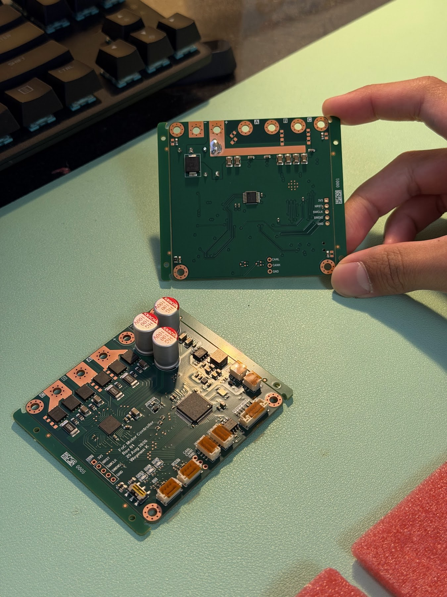

**Status:** Rev 1 is design-frozen, fabricated, brought up and bench-characterized up to 30 V and 10 A (2026-11-22). What it can and cannot do is summarized just below; the full story, test by test, is the [test and bring-up report](Testing/README.md). Not yet tested on the 12S bus, under shaft load, or with the encoder.

| | |
|---|---|
| Bus | 12S LiPo: 44.4 V nominal, 50.4 V full, 56 V max |
| Phase current | 10 A RMS continuous (design target) |
| MCU | STM32G431RB, 170 MHz Cortex-M4F |
| Gate driver | TI DRV8323S (SPI, 3 integrated current-sense amplifiers) |
| Power stage | 6 × Infineon ISC030N10NM6, 100 V, TDSON-8 |
| Current sensing | 3 × 3 mΩ low-side shunts, Kelvin-connected |
| Position | AS5047P 14-bit magnetic encoder, on the back of the board under the motor shaft |
| Comms | CAN-FD (TCAN1044), UART to the bench GUI, SWD |
| Power tree | SMCJ51CA TVS → LMR36520 buck to 5 V → LDO to 3.3 V |
| Board | 70 × 70 mm, 6 layers, KiCad 10, fabricated and assembled by JLCPCB |

---

## Renders

  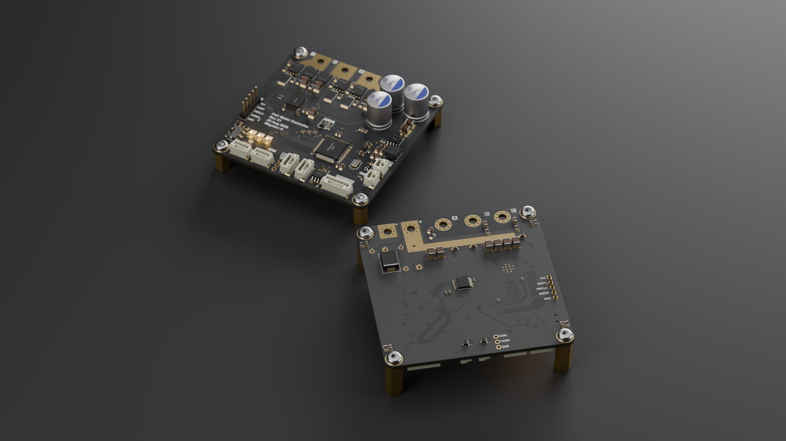

<table>
  <tr>
    <td></td>
    <td></td>
  </tr>
  <tr>
    <td align="center">Top: bridge, DRV8323S, STM32G431, bulk caps, connectors</td>
    <td align="center">Bottom: power bus, phase pads, AS5047P encoder</td>
  </tr>
</table>

Rendered in Blender (Cycles) from the KiCad board and the fabrication Gerbers, on brass M3 standoffs.

## On the motor

Rendered with the ODrive M8325s (100 KV, 20 pole pairs), the reference motor for the leg joint, on the 3D-printed test upright.

  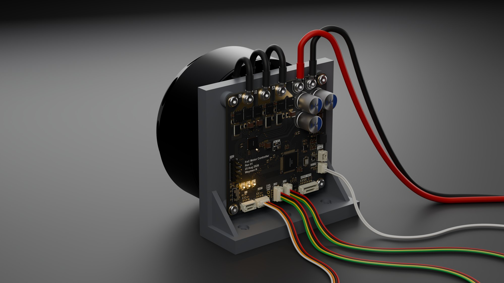

<table>
  <tr>
    <td>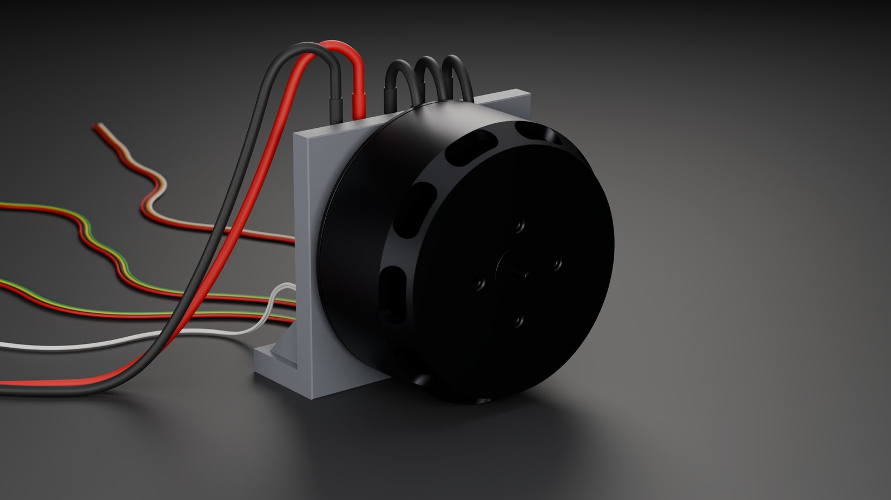</td>
    <td></td>
  </tr>
  <tr>
    <td align="center">Motor side of the test upright</td>
    <td align="center">Motor shown transparent: the diametric magnet sits on the shaft axis over the AS5047P</td>
  </tr>
</table>

  

## PCB layout

  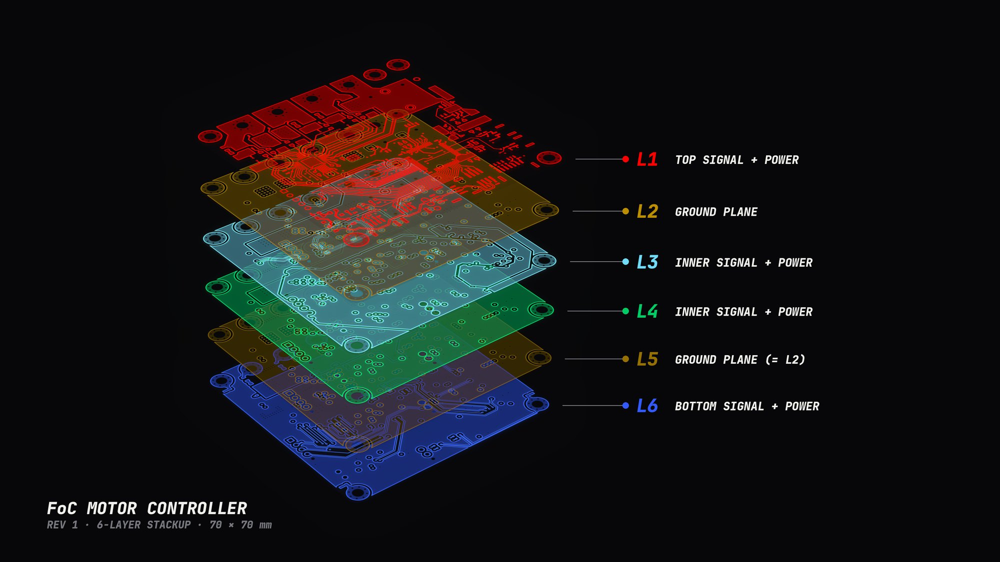

Stackup: L1 signal + power, L2 ground, L3 / L4 signal + power, L5 ground (identical to L2), L6 signal + power. Phase and bus current run in outer-layer pours; the DRV8323S sits next to the bridge to keep the gate loops short.

  

All signal layers, full size

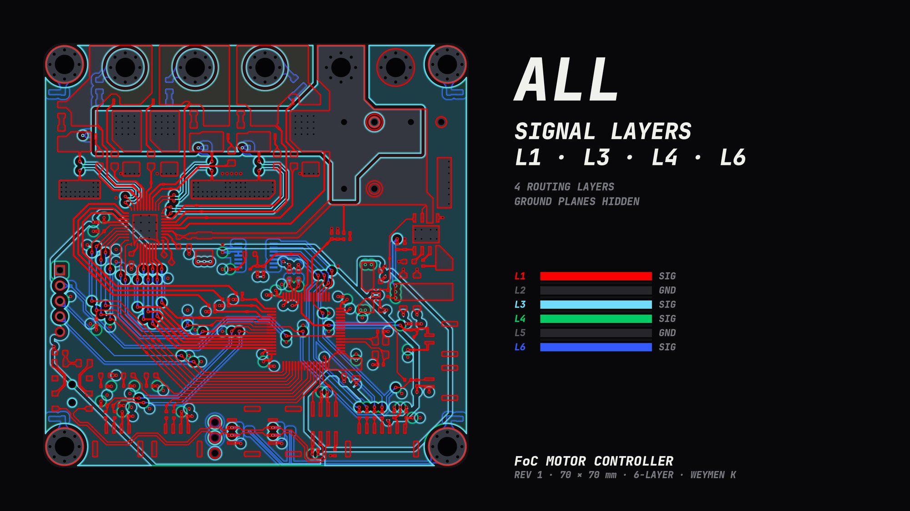

Plots of every copper, mask, paste and silkscreen layer are in [`Hardware/Project Outputs/PCB Layers PDF/`](Hardware/Project%20Outputs/PCB%20Layers%20PDF/). The full board drawing is [`FoC_Motor_Controller_PCB_Artwork.pdf`](Documentation/FoC_Motor_Controller_PCB_Artwork.pdf).

## Simulation vs scope

Three LTspice decks built from the Rev 1 netlist, each predicting what a bench measurement on a Rigol DHO804 should show, then checked against the scope captures. Full slides: [`FOC_Motor_Controller_Sim_and_Bench_Results.pdf`](Documentation/FOC_Motor_Controller_Sim_and_Bench_Results.pdf). Decks, raw captures and scripts: [`Testing/Simulation/`](Testing/Simulation/).

| | Simulation | Bench vs simulation |
|---|---|---|
| **1 · Hot-plug** (XT60 into a live supply) |  | 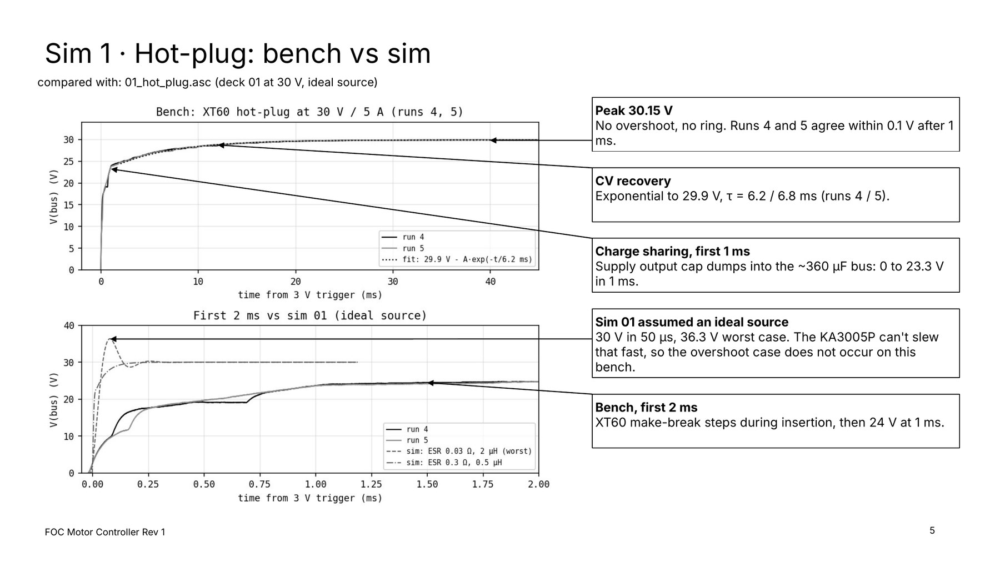 |
| **2 · Half-bridge switching** (one leg, hard edges) | 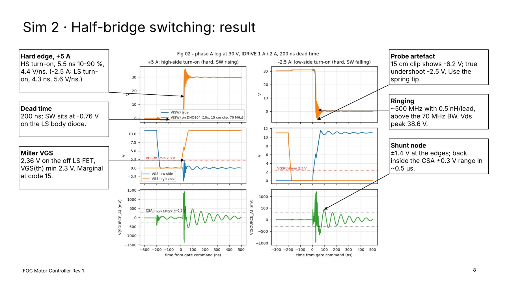 |  |
| **3 · Current sense** (standstill hold, I/f spin) |  |  |

Bench results (12 V supply; hot-plug at 30 V):

- **Hot-plug:** 30.15 V peak, no overshoot. The bench supply limits the charge rate, so the 36.3 V overshoot the ideal-source sim predicts doesn't occur on this supply.
- **Switching:** 8.8 ns rise and 13.87 V peak at 12 V, against 7.0 ns in the sim. The difference is mostly the 70 MHz probe.
- **Current sense:** the I/f spin at 2 A / 300 rpm gives a 2.04 A envelope, and the 112 mV pulse matches the sim's 120 mV.

## What this board can and cannot do

From the [test and bring-up report](Testing/README.md), which walks through every test: why it was done, what was found, and what changed because of it.

  

**It can**

- Switch 30 V cleanly up to 10 A per phase, once the gate drive is slowed from the driver's default.
- Measure phase current within 1–2 %, with about 25 mA of noise per sample, up to roughly 95 % duty.
- Run a motor without an encoder: closed-loop speed to 3000 rpm, 50 starts out of 50, and position hold with a current vector.
- Protect itself from overload in firmware within about 50 µs, and from a short circuit through the gate driver (trip measured at 22–23 A at its lowest setting).
- Survive a supply sag to 5 V, a lost control link, and regenerative braking, without latching up or over-volting the bus.

**It cannot**

- Run at the gate driver's power-on settings: they put −10 V on a pin rated for −7 V and leave the short-circuit trip at about 280 A. The firmware overrides both.
- Absorb braking energy. One stop of the bare rotor raises a 12 V bus by 11 V, so firmware refuses to brake above a voltage limit.
- Read all three phase currents above about 95 % duty.
- Be stopped by a hardware E-stop; on Rev 1 that is the supply's switch.
- Sense rotor position at standstill under load without the encoder.

**Not yet known:** anything above 30 V or 10 A (including the 56 V design point), FET temperature at 10 A, efficiency under load, EMC.

## Bench GUI: FOCLINK

FOCLINK is the bench console: a PySide6 app styled as a NERV operations terminal, talking to the firmware over UART. The GUI holds no safety logic; it only requests, and the firmware decides what is allowed. The firmware and GUI live in a separate repository.

  

<table>
  <tr>
    <td>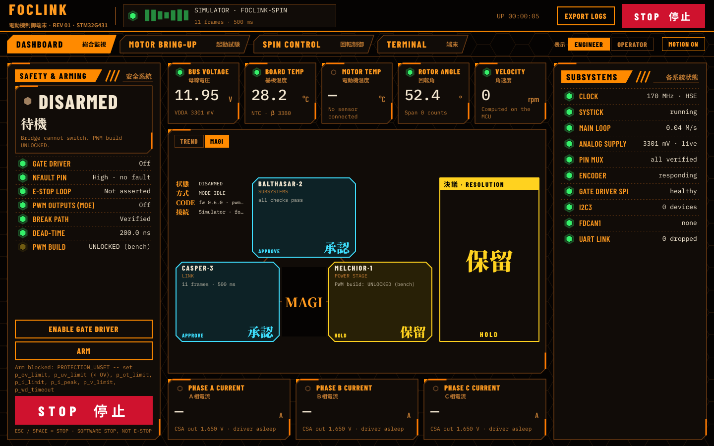</td>
    <td>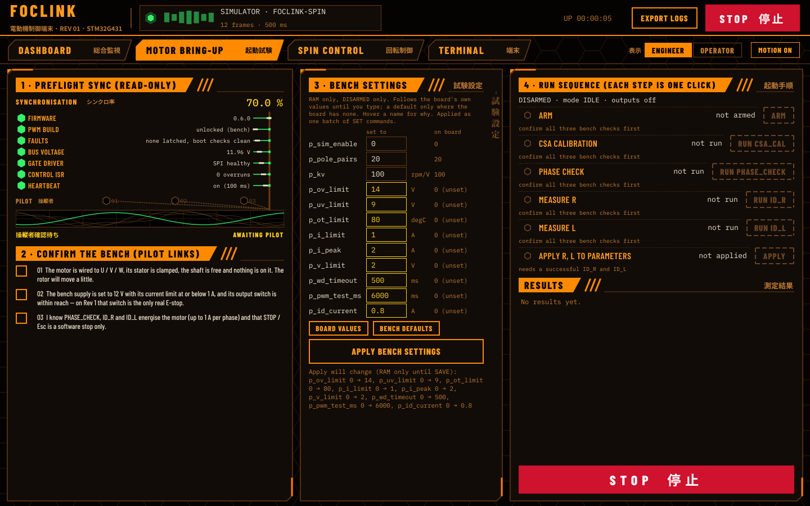</td>
  </tr>
  <tr>
    <td align="center"><b>MAGI 合議</b>: power stage, subsystems and link summarised as three votes</td>
    <td align="center"><b>Motor bring-up 起動試験</b>: preflight sync, then phase check, R and L identification</td>
  </tr>
  <tr>
    <td>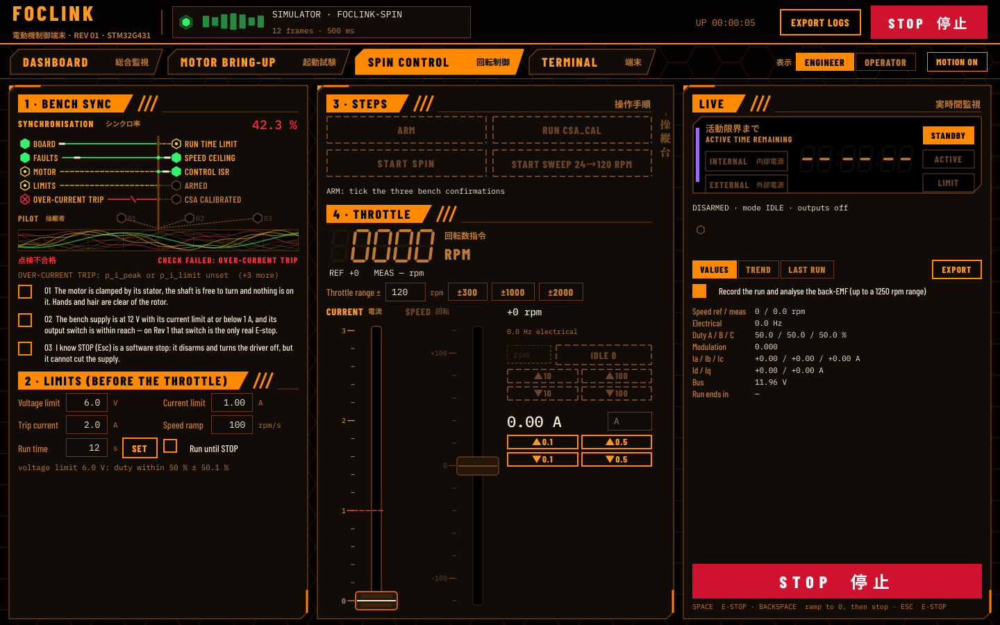</td>
    <td></td>
  </tr>
  <tr>
    <td align="center"><b>Spin control 回転制御</b>: limits first, then the open-loop I/f throttle</td>
    <td align="center"><b>Terminal 端末</b>: console, parameters, scope, DRV8323 registers</td>
  </tr>
</table>

Screenshots are from the GUI's built-in board simulator (`python -m focgui --sim foclink-spin`), not a live board.

---

## Documents

| File | What it is |
|---|---|
| [`FoC_Motor_Controller_Schematic.pdf`](Documentation/FoC_Motor_Controller_Schematic.pdf) | Full schematic, 12 hierarchical sheets |
| [`FoC_Motor_Controller_PCB_Artwork.pdf`](Documentation/FoC_Motor_Controller_PCB_Artwork.pdf) | Board drawing |
| [`FOC_Motor_Controller_Sim_and_Bench_Results.pdf`](Documentation/FOC_Motor_Controller_Sim_and_Bench_Results.pdf) | Simulation and bench-correlation slides |

## Repository layout

| Path | Contents |
|---|---|
| `Documentation/*.pdf` | Schematic, PCB artwork, sim-vs-bench results (above) |
| `Hardware/FoC Motor Controller.kicad_pro` / `.kicad_sch` / `.kicad_pcb` | KiCad 10 project, root sheet and board |
| `Hardware/Schematics/` | Hierarchical sheets: power input and generation, MCU, gate driver, MOSFETs, sensing, CAN-FD, interconnects, position, LEDs |
| `Hardware/Libraries/` | Project-local symbols, footprints and 3D models (`${KIPRJMOD}/Libraries/`) |
| `Testing/Simulation/` | LTspice bench-correlation suite with DHO804 captures; see [`Testing/Simulation/README.md`](Testing/Simulation/README.md) |
| `Testing/README.md` | **The test and bring-up report**: every test in order, why, what was found, what changed |
| `Testing/Bench/` | Lab notebook, raw captures, report figures, probe map |
| `Hardware/Project Outputs/` | BOM, pick-and-place, netlist, Rev 1 fabrication package, per-layer PDFs |
| `Documentation/images/` | Board photo, renders, layer views, sim-vs-bench figures, GUI screenshots |

Open `Hardware/FoC Motor Controller.kicad_pro` in KiCad 10. Vendor datasheets and the KiCad worksheet templates are not included; without the templates KiCad falls back to its default title block.

## Rev 2, top items

1. Thermal vias in the low-side drain pads, or a bottom-side switch-node pour
2. Board NTC moved into the FET zone
3. Separate analog 3.3 V rail (ferrite + local caps) for VDDA / VREF+
4. More bulk capacitance, or a lower-ESR part
5. Hardware CAN node addressing

Measured inputs for the next revision (braking energy path, ADC input mapping, leg C's commutation loop, shunt layout, probe points) are in the [test and bring-up report](Testing/README.md#part-5-what-changed-because-of-all-this).
