# FoC Motor Controller · Rev 1

A single-axis, sensored field-oriented-control (FOC) motor controller for one joint of a cat-scale bipedal robot: 70 × 70 mm, 6 layers, built for a 12S bus. Six boards (one per joint) are planned, sharing the bus and talking over CAN-FD.

  

**Status:** Rev 1 is design-frozen, fabricated, brought up and bench-characterized up to 30 V and 10 A (2026-11-22). Results from the most recent bench session are [below](#bench-session-22-november-2026). Not yet tested on the 12S bus, under shaft load, or with the encoder.

**Who did what.** The firmware was developed by Claude (Anthropic's AI model), including every firmware change listed in the bench session below. I am responsible for the electrical bring-up and the engineering decisions: what to test, how to read the results, which limits the firmware must enforce, and what changes in Rev 2.

| | |
|---|---|
| Bus | 12S LiPo: 44.4 V nominal, 50.4 V full, 56 V max |
| Phase current | 10 A RMS continuous (design target) |
| MCU | STM32G431RB, 170 MHz Cortex-M4F |
| Gate driver | TI DRV8323S (SPI, 3 integrated current-sense amplifiers) |
| Power stage | 6 × Infineon ISC030N10NM6, 100 V, TDSON-8 |
| Current sensing | 3 × 3 mΩ low-side shunts, Kelvin-connected |
| Position | AS5047P 14-bit magnetic encoder, on the back of the board under the motor shaft |
| Comms | CAN-FD (TCAN1044), UART to the bench GUI, SWD |
| Power tree | SMCJ51CA TVS → LMR36520 buck to 5 V → LDO to 3.3 V |
| Board | 70 × 70 mm, 6 layers, KiCad 10, fabricated and assembled by JLCPCB |

---

## Renders

  

<table>
  <tr>
    <td>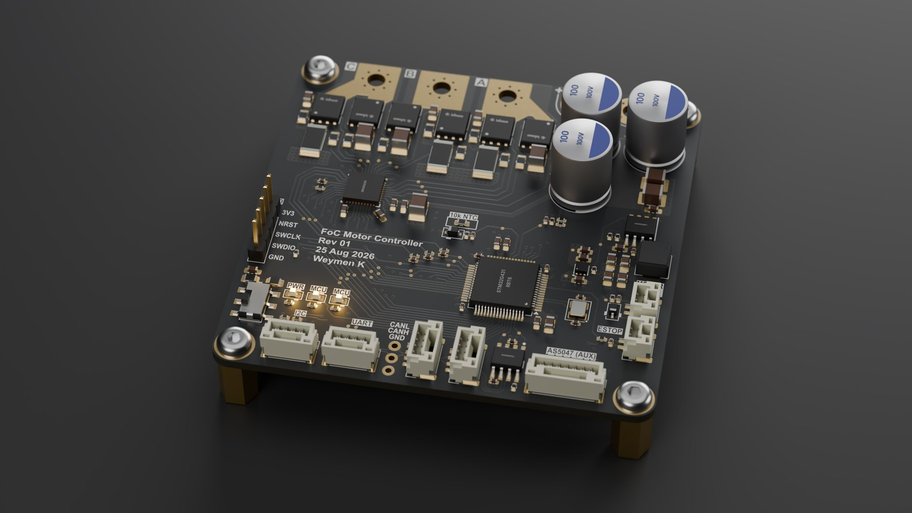</td>
    <td>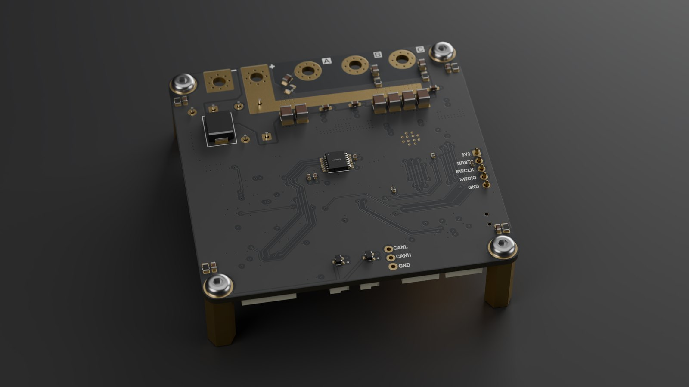</td>
  </tr>
  <tr>
    <td align="center">Top: bridge, DRV8323S, STM32G431, bulk caps, connectors</td>
    <td align="center">Bottom: power bus, phase pads, AS5047P encoder</td>
  </tr>
</table>

Rendered in Blender (Cycles) from the KiCad board and the fabrication Gerbers, on brass M3 standoffs.

## On the motor

Rendered with the ODrive M8325s (100 KV, 20 pole pairs), the reference motor for the leg joint, on the 3D-printed test upright.

  

<table>
  <tr>
    <td></td>
    <td>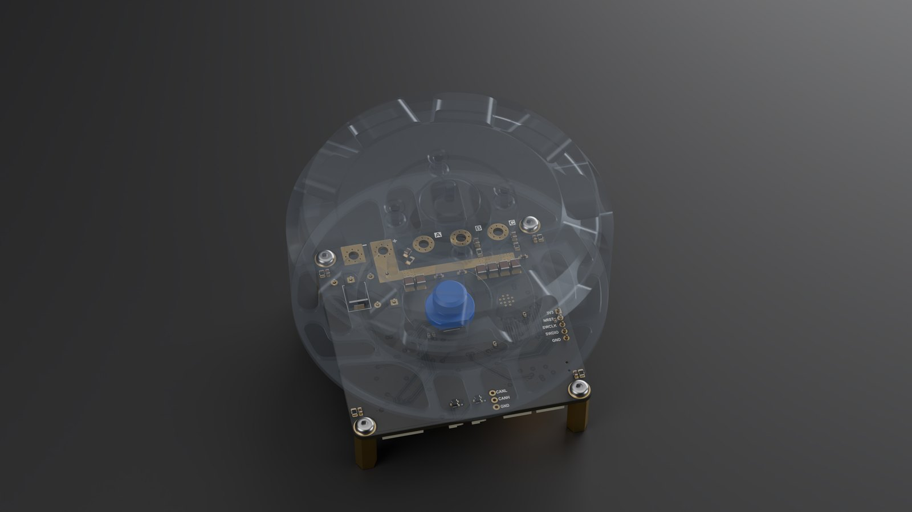</td>
  </tr>
  <tr>
    <td align="center">Motor side of the test upright</td>
    <td align="center">Motor shown transparent: the diametric magnet sits on the shaft axis over the AS5047P</td>
  </tr>
</table>

  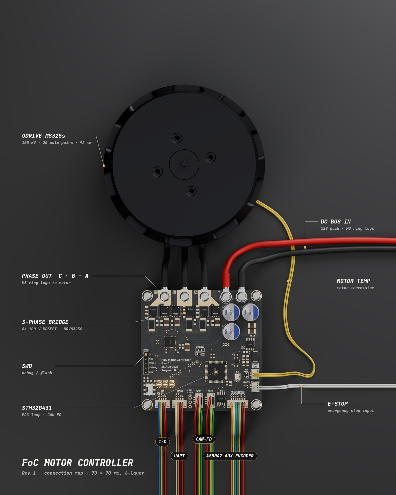

## PCB layout

  

Stackup: L1 signal + power, L2 ground, L3 / L4 signal + power, L5 ground (identical to L2), L6 signal + power. Phase and bus current run in outer-layer pours; the DRV8323S sits next to the bridge to keep the gate loops short.

  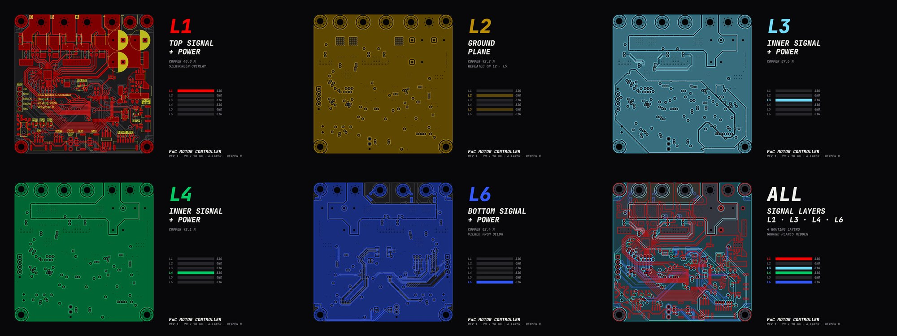

All signal layers, full size

Plots of every copper, mask, paste and silkscreen layer are in [`Hardware/Project Outputs/PCB Layers PDF/`](Hardware/Project%20Outputs/PCB%20Layers%20PDF/). The full board drawing is [`FoC_Motor_Controller_PCB_Artwork.pdf`](Documentation/FoC_Motor_Controller_PCB_Artwork.pdf).

## Bench GUI: FOCLINK

FOCLINK is the bench console: a PySide6 app styled as a NERV operations terminal, talking to the firmware over UART. The GUI holds no safety logic; it only requests, and the firmware decides what is allowed. The firmware and GUI live in a separate repository.

  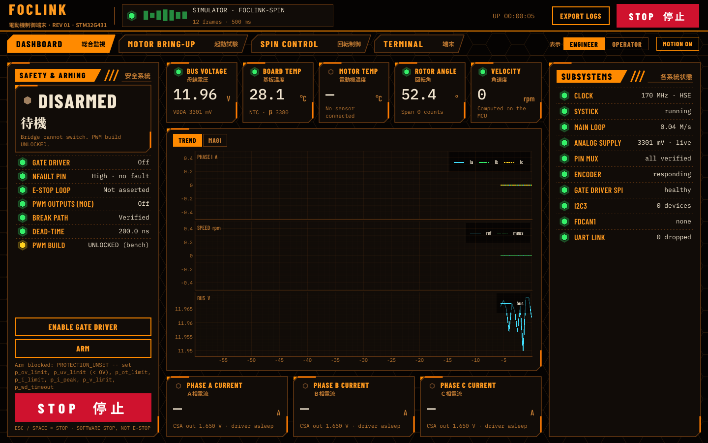

<table>
  <tr>
    <td></td>
    <td></td>
  </tr>
  <tr>
    <td align="center"><b>MAGI 合議</b>: power stage, subsystems and link summarised as three votes</td>
    <td align="center"><b>Motor bring-up 起動試験</b>: preflight sync, then phase check, R and L identification</td>
  </tr>
  <tr>
    <td></td>
    <td>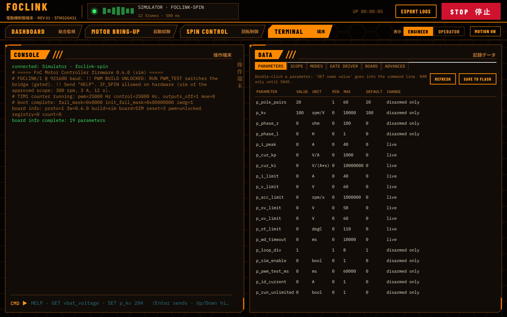</td>
  </tr>
  <tr>
    <td align="center"><b>Spin control 回転制御</b>: limits first, then the open-loop I/f throttle</td>
    <td align="center"><b>Terminal 端末</b>: console, parameters, scope, DRV8323 registers</td>
  </tr>
</table>

Screenshots are from the GUI's built-in board simulator (`python -m focgui --sim foclink-spin`), not a live board.

## Bench session, 22 November 2026

One day of power-stage characterization on a 30 V / 5 A bench supply (Korad KA3005P), with a 70 MHz scope and
hand-held ×10 probes (Rigol DHO804), a DMM and a thermocouple. No encoder magnet mount and no dynamometer: the
T-Motor MN601-S was used as an inductive load, either parked by a DC current vector or spinning unloaded without the
encoder. The aim was to find what the firmware must respect, and what Rev 2 has to change.

<table>
  <tr>
    <td width="57%">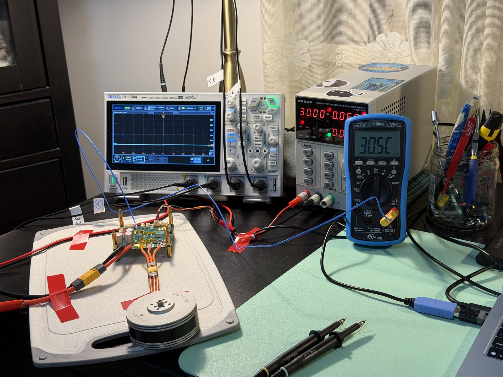</td>
    <td width="43%">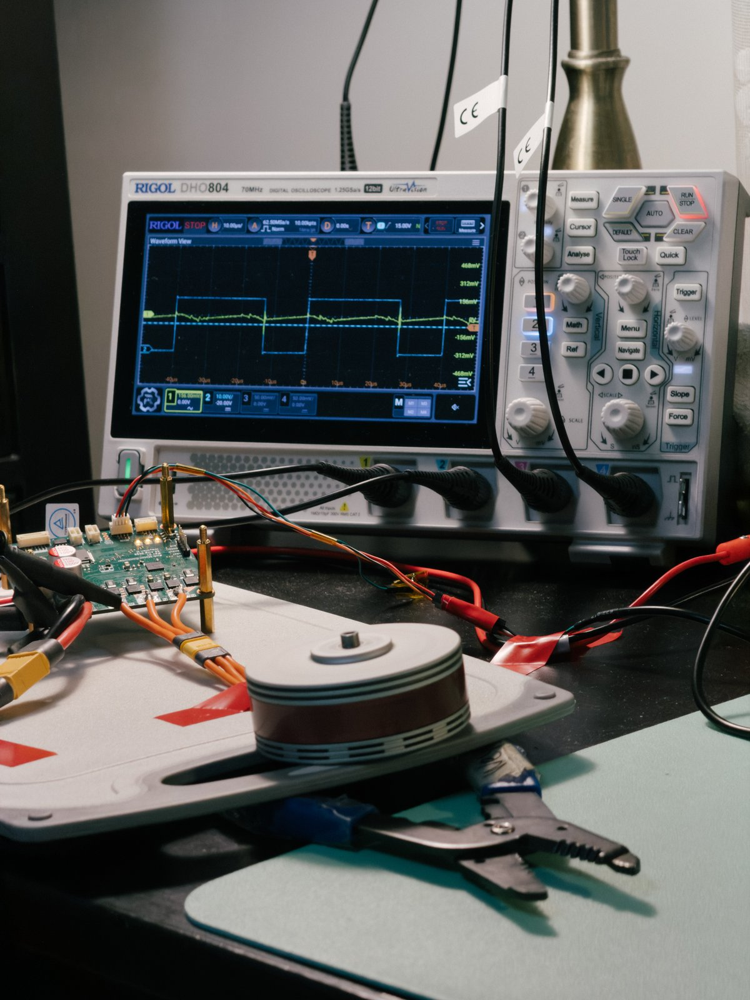</td>
  </tr>
</table>

**Result in one paragraph.** At 30 V and up to 10 A the board switches cleanly, measures its own current to within
1–2 % and protects itself, **but only after three of the gate driver's power-on settings were changed**. At its defaults
the DRV8323 puts −10 V on a pin rated −7 V and its short-circuit trip sits at about 280 A. The board cannot absorb
braking energy, cannot read all three phase currents above about 95 % duty, and has no hardware E-stop. Nothing above
30 V, above 10 A, under shaft load or with the encoder has been tested yet.

### Switching: the edge that broke the rating

With current flowing *out* of a phase, the high-side FET makes the hard edge, and it looked clean:

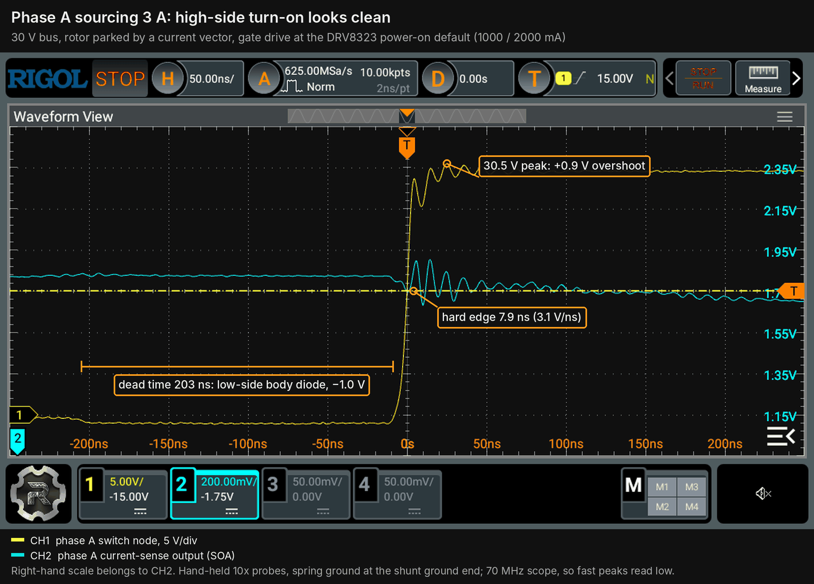

Reversing the current moves the hard edge to the low-side FET. At the gate driver's default gate current, the switch
node rings to −10 V against the DRV8323's −7 V absolute maximum, and the shunt pins see −4.6 V against ±3 V. Every
earlier run had done this whenever a phase sank current.

<table>
  <tr>
    <td>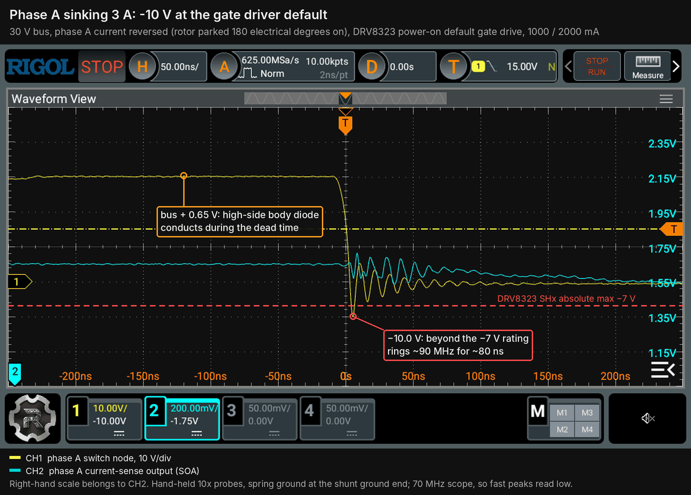</td>
    <td>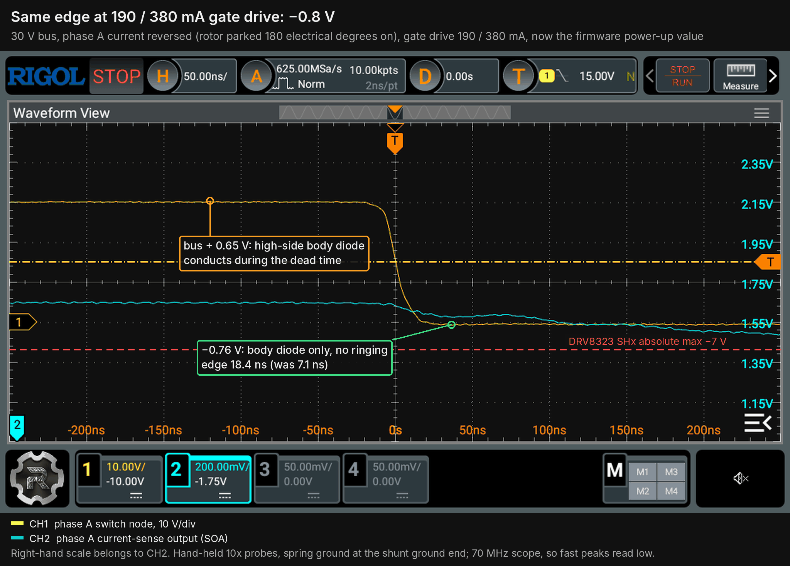</td>
  </tr>
</table>

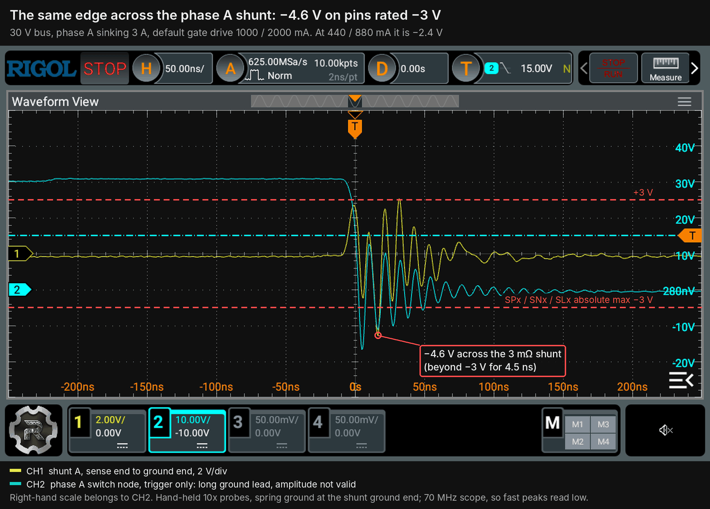

| Gate current (source / sink) | Edge time | Switch-node minimum | Across the shunt |
|---|---|---|---|
| 1000 / 2000 mA (DRV8323 default) | 7.1 ns | **−10.0 V** | **−4.6 V** |
| 440 / 880 mA | 8.9 ns | −2.7 V | −2.4 V |
| 190 / 380 mA (now the default) | 18.4 ns | −0.8 V | — |

Repeated on all three phases, at 12, 24 and 30 V, and up to 10 A:

- **Bus voltage does not matter:** −2.7 V at 12, 24 and 30 V. The ringing is set by the edge and the layout, which is
  good news for the 56 V design point (still unproven above 30 V).
- **Current barely matters:** about −0.1 V per amp. Phase C at 10 A still reads −1.1 V at the slow setting (below).
- **Phase C is worse than A and B**, in five of five probe placements at 440 / 880 mA: its commutation loop is larger.
  At 190 / 380 mA, phase C readings depend on where the probe sits by up to 2.5 V; the worst one (−3.5 V) is the one
  used for margins.
- The cost of the slow setting is about 10 ns of edge time and roughly 20 mW per phase.

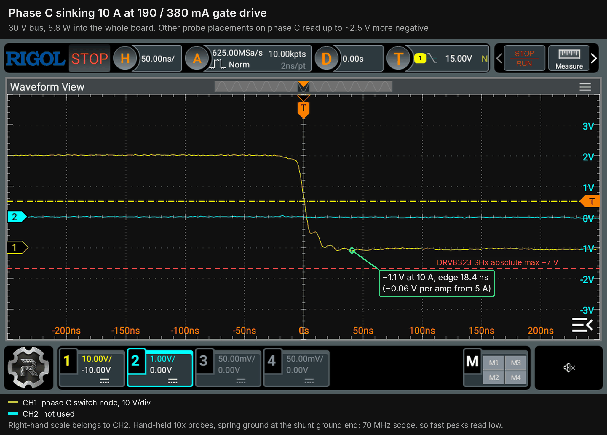

### Protection

**Firmware over-current trip.** The outputs go off 9.5 µs after the ADC sample that sees the over-current, the same in
four of four trips. With one sample per 40 µs period, the worst case is about 50 µs: fine for overload, far too slow
for a short circuit.

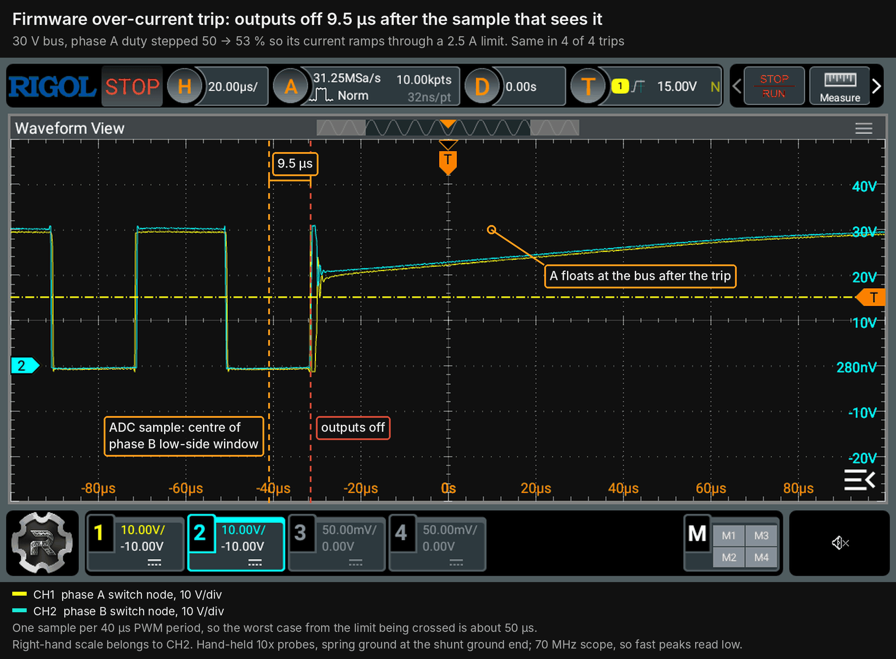

**Gate-driver short-circuit trip.** With the DRV8323 VDS threshold at its lowest (0.06 V), phase A's current was ramped
in steps, using the firmware trip as a ceiling at 10, 15, 20 and 22 A. At 22 A the gate driver tripped first, three
times out of three. 0.06 V across 2.7 mΩ (the FET on-resistance) is 22 A, so the **power-on setting of 0.75 V means a
trip at about 280 A**: no usable short-circuit protection. It is now set to 0.13 V (about 48 A cold, 30 A hot). Above
about 22 A the current sense saturates, so firmware can neither see nor limit current there.

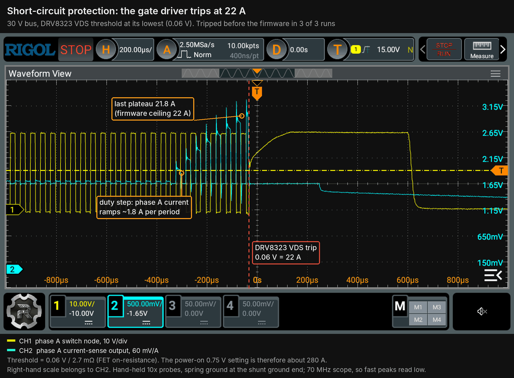

**Losing power, losing the link.**

| Event | Behaviour |
|---|---|
| Supply ramped 30 → 4 → 30 V | Runs down to 5 V, off at 4 V, clean restart between 5 and 6 V. Draws more as the bus falls (27 mA at 12 V, 64 mA at 5 V) |
| Heartbeat stopped while switching | Outputs off at 501 ms for a 500 ms setting, 5 of 5 |
| STOP / DISARM command | Acted on in 11–44 ms, mostly USB-serial delay |
| 50 sensorless starts | 50 reached closed loop, 2.45 s each ± 40 ms |

### Current sensing

| Check | Result |
|---|---|
| Scale (battery DMM floating across one shunt, 3 A and 5 A holds) | Correct within 1–2 % |
| Offsets, 12 to 30 V | Move less than 7 mA |
| Noise | 20–27 mA rms per sample, switching or not |
| Bus voltage reading | 0.36 % low at 30 V |

**High duty.** Low-side shunts carry the phase current only while the low-side FET is on. Phases A and B read correctly
down to a 1.2 µs window; phase C fails at about 3 µs (half the true current at 95 % duty). The cause is in the
schematic: A and B are each converted first on their ADC, while C is second in a sequence, 0.9–1.5 µs later, after its
window has closed. The firmware now rebuilds the phase with the shortest window from the other two. Above about 95 %
duty two phases are unreadable.

### Dead time

Measured without probes, from the voltage needed to hold 1–5 A (the bridge's voltage error is a direct measure of the
effective dead time).

| MCU dead time | DRV8323 dead time | Voltage error at 5 A |
|---|---|---|
| 200 ns | 100 ns | 229 mV |
| 100 ns | 100 ns | 229 mV |
| 200 ns | 50 ns | 186 mV |

Halving the MCU's dead time changes nothing: the gate driver waits for the outgoing gate to fall and then adds its own,
and at the slow gate drive that already exceeds 200 ns. MCU stays at 200 ns; the driver is set to 50 ns. No
shoot-through at any setting (switching power at zero current unchanged, no faults).

### Braking

A braking motor is a generator, and the bench supply cannot sink current. Speed was dropped abruptly to 300 rpm with up
to 3 A of braking, from a 12 V bus.

| Stop | Peak bus |
|---|---|
| Up to 1 A of braking | No rise: the board's own consumption takes it |
| 3 A, from 1000 rpm | 12 → 23 V |
| 3 A, from 2000 and 2500 rpm, with a clamp at 0.9 × the 30 V limit | Held within 0.1 V of the clamp, 4 of 4 |

That was a bare rotor holding at most about 2.7 J; the bus capacitors take about 0.13 J between 12 and 30 V. A robot
joint stores far more. Firmware now withdraws braking above 90 % of the over-voltage limit, and Rev 2 needs a braking
resistor or an active clamp.

### Heat, rails, bus

| Check | Result |
|---|---|
| Low-side FET case, 10 min hold, still air | +7.5 °C at 3 A, +10.2 °C at 5 A (10 A hold not yet run) |
| Board temperature sensor | Reads 1.5–2 °C above the FET case |
| Whole board holding 10 A | 5.8 W from the supply |
| +3.3 V rail | At the scope's noise floor |
| +5 V rail | About 100 mV ripple at 120–160 kHz from its own converter at light load |
| Bus ripple, spinning 1000–3000 rpm | 58–79 mV p-p between edges |

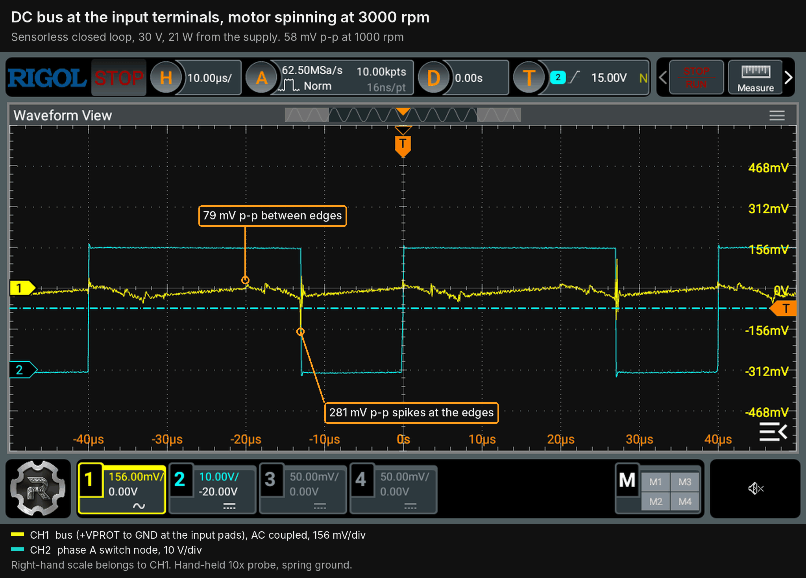

### Motor constants

- **Flux constant:** with the outputs off and the rotor coasting, the back-EMF gives 1.396 mV·s, within 0.5 % of the
  value in the firmware.
- **Resistance:** four-wire with the motor unplugged, 17.97 mΩ per phase (datasheet 39 mΩ line to line). The 98 mΩ the
  firmware identified in September came from the bench supply's leads (110–145 mΩ) and the bridge's voltage error at 1 A.

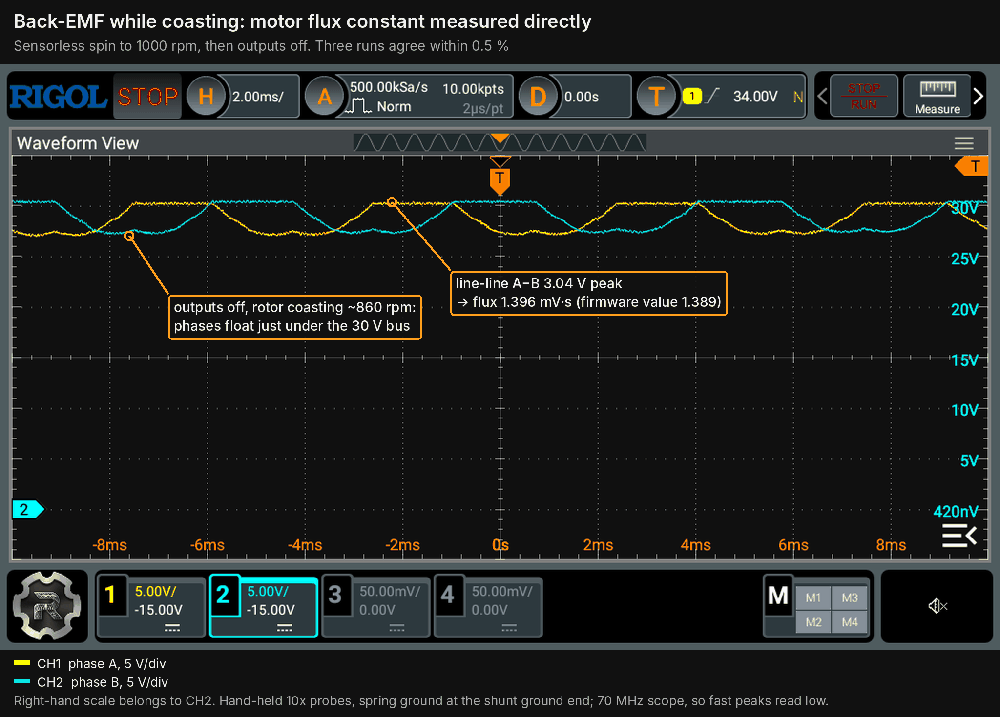

### Running without an encoder

There is no encoder magnet mount yet, so sensorless modes were added to the firmware for this session: a speed loop that
starts open-loop and hands over to a flux observer, and a position mode that parks the rotor with a current vector
(used as the electronic load for most of the tests above). Closed-loop speed reached 3000 rpm unloaded, drawing 6 W at
1000 rpm and 21 W at 3000 rpm. A standstill saliency scan finds the rotor angle with no torque current, but cannot
track it under load on this ~9 µH motor: the bridge's voltage error is larger than the signal.

### Decisions from the session

**Firmware limits** (my decisions; implemented by Claude, verified on the board):

| Change | Why |
|---|---|
| Gate current 190 / 380 mA at power-up, capped at 440 / 880 mA | −10 V on a −7 V pin at the default |
| VDS short-circuit threshold 0.13 V, cannot be loosened | Default 0.75 V is a ~280 A trip |
| DRV8323 dead time 50 ns; MCU stays at 200 ns | The driver sets the real dead time |
| Phase with the shortest low-side window rebuilt from the other two | Phase C is sampled after its window closes |
| Braking withdrawn above 90 % of the over-voltage limit | Nowhere for braking energy to go |
| Over-current check moved ahead of the encoder read | Shorter trip latency |

**Rev 2**

| Priority | Change | Why |
|---|---|---|
| High | Braking resistor or active bus clamp sized for the joint's energy | Braking |
| High | Current-sense outputs routed so both ADCs sample together, none second in a sequence | Phase C at high duty |
| High | Hardware E-stop input independent of the gate driver's enable | Rev 1 has none: the E-stop was the supply switch |
| Medium | Review phase C's commutation loop against A and B | Phase C rings harder |
| Medium | Low-inductance shunt layout, Kelvin sensing, input filter | −4.6 V on the shunt pins |
| Medium | Gate resistors (or footprints) so edge rate does not depend on a register that powers up at its fastest | −10 V at the default |
| Medium | Test points with a ground pad beside each: switch nodes, shunts, driver pins | Hand-held probe readings varied by up to 2.5 V |
| Low | Stronger pull-up on the DRV8323 SPI data line | Bring-up |
| Low | Non-blocking encoder read | Takes 3.5 µs of each 40 µs period |
| Low | Quieter +5 V rail if anything sensitive is added to it | Rails |

### Limits of these numbers

- Not tested: above 30 V and 10 A (the 56 V design point is extrapolation), FET temperature at 10 A, the gate driver's
  reaction time on a short-circuit trip, efficiency under shaft load, the high-side gate waveform, EMC, anything using
  the encoder.
- A 70 MHz scope and hand-held probes under-read 7–9 ns edges: real peaks are higher than stated.
- Switch-node voltages are measured against the shunt's ground end, not the gate driver's ground pin.
- Braking energies rest on an estimated rotor inertia, and the supply's output capacitor was in parallel with the bus.

Every run, including failed and repeated ones, is in the lab notebook [`Testing/Bench/CHAR_LOG.md`](Testing/Bench/CHAR_LOG.md),
with raw waveforms and screenshots in [`Testing/Bench/char/`](Testing/Bench/char/). The annotated captures above are made
from those by [`annotate_scope.py`](Testing/Bench/annotate_scope.py).

---

## Documents

| File | What it is |
|---|---|
| [`FoC_Motor_Controller_Schematic.pdf`](Documentation/FoC_Motor_Controller_Schematic.pdf) | Full schematic, 12 hierarchical sheets |
| [`FoC_Motor_Controller_PCB_Artwork.pdf`](Documentation/FoC_Motor_Controller_PCB_Artwork.pdf) | Board drawing |
| [`DESIGN.md`](Documentation/DESIGN.md) | Design decisions and why: requirements, revision history, part choices |
| [`FOC_Motor_Controller_Sim_and_Bench_Results.pdf`](Documentation/FOC_Motor_Controller_Sim_and_Bench_Results.pdf) | Earlier LTspice decks compared with scope captures (October 2026) |

## Repository layout

| Path | Contents |
|---|---|
| `Documentation/` | Schematic and PCB artwork PDFs, design decisions, images, annotated scope captures |
| `Hardware/FoC Motor Controller.kicad_pro` / `.kicad_sch` / `.kicad_pcb` | KiCad 10 project, root sheet and board |
| `Hardware/Schematics/` | Hierarchical sheets: power input and generation, MCU, gate driver, MOSFETs, sensing, CAN-FD, interconnects, position, LEDs |
| `Hardware/Libraries/` | Project-local symbols, footprints and 3D models (`${KIPRJMOD}/Libraries/`) |
| `Testing/Simulation/` | LTspice decks, results and the matching scope captures |
| `Testing/Bench/` | Lab notebook, raw scope captures, probe map, bench scripts |
| `Hardware/Project Outputs/` | BOM, pick-and-place, netlist, Rev 1 fabrication package, per-layer PDFs |

Open `Hardware/FoC Motor Controller.kicad_pro` in KiCad 10. Vendor datasheets and the KiCad worksheet templates are not included; without the templates KiCad falls back to its default title block.
