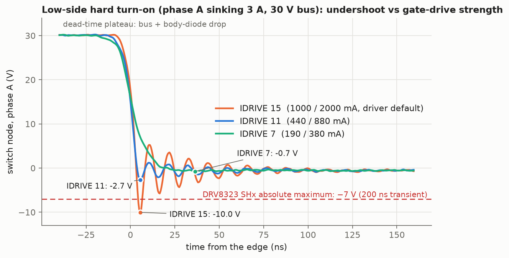
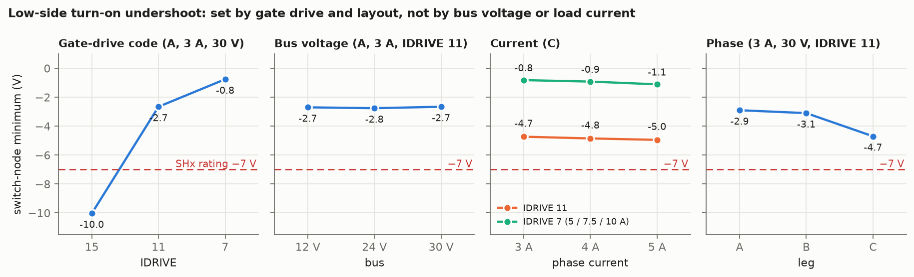
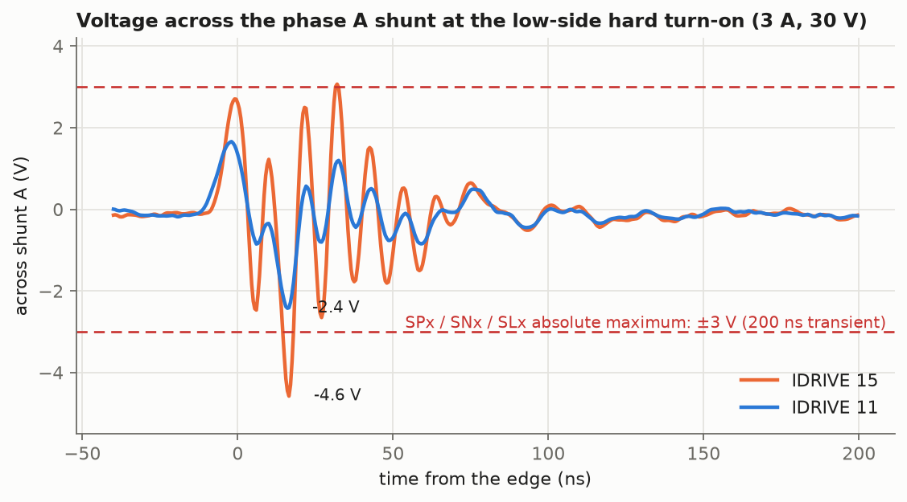
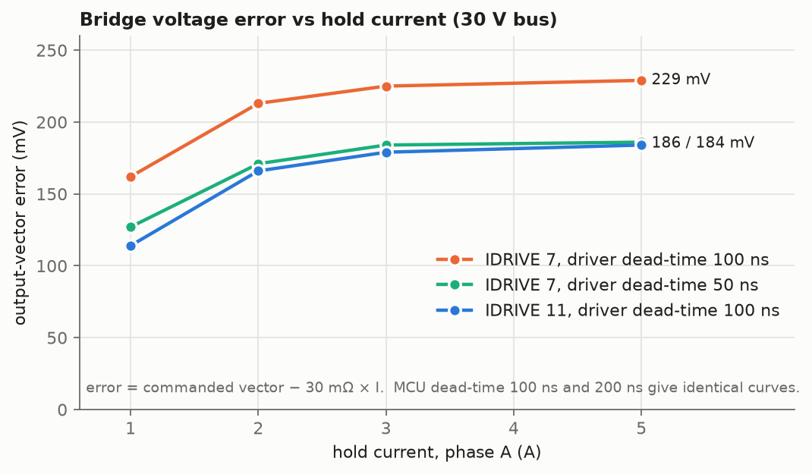
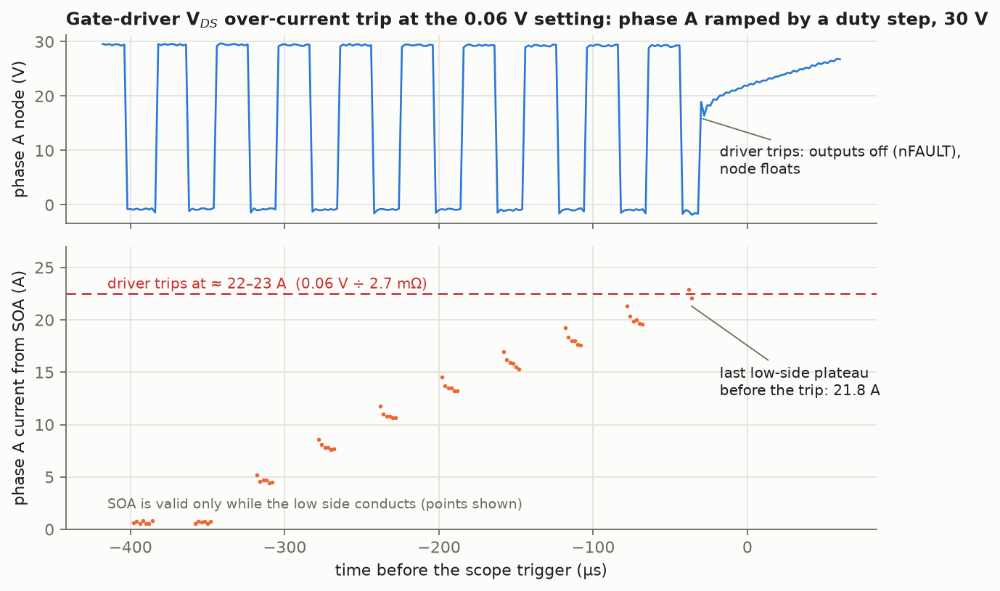
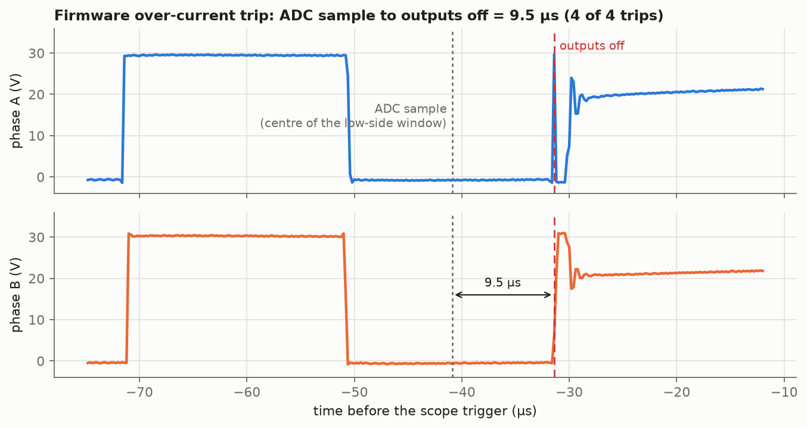
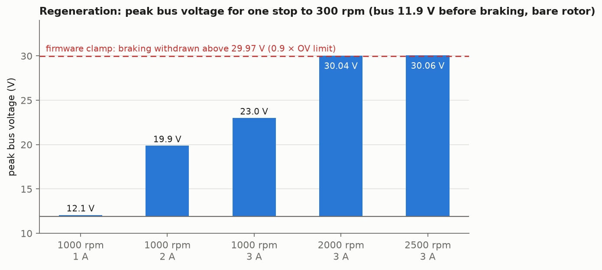
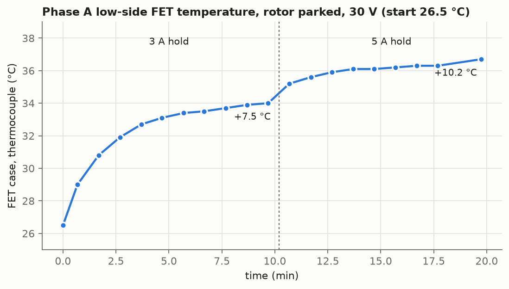
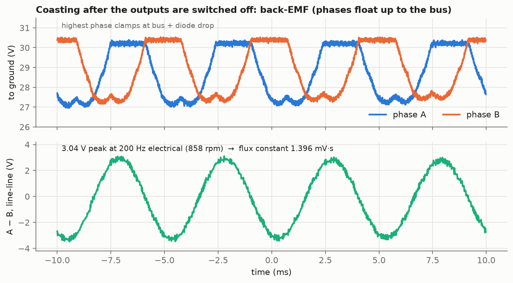

# Rev 1 power-stage characterization report

**Board:** FOC motor controller Rev 1 — STM32G431RBT6, DRV8323S gate driver, 6 × ISC030N10NM6, 3 mΩ low-side shunts,
~350 µF bus, 25 kHz centre-aligned PWM. Design point: 12S (56 V max), 10 A rms per phase.
**Purpose:** give firmware a measured operating envelope, and give Rev B a list of changes with the evidence behind each.
**Date:** 2026-11-22. **Status:** complete for what this bench can reach; open items are listed in section 6.

The motor (T-Motor MN601-S) is only a tool here: parked by a DC current vector it is an inductive load, spun unloaded it
provides real power flow and a source of kinetic energy. Everything in sections 1–4 is a property of the board.

## 1. Summary

| # | Finding | Consequence |
|---|---|---|
| 1 | With the DRV8323's power-on gate current (1 A / 2 A) the switch node undershoots to **−10 V** at low-side turn-on. The driver's rating is −7 V. | Gate current reduced to 190 / 380 mA in firmware: −0.8 V on phase A, clean to 10 A. |
| 2 | The driver's short-circuit threshold at its power-on value (0.75 V) corresponds to **≈ 280 A**. The trip itself works: 22–23 A at the 0.06 V setting. | Threshold set to 0.13 V (≈ 48 A cold, ≈ 30 A hot). |
| 3 | Braking returns energy the bus cannot hold: **+11 V on a 12 V bus** from one stop of the bare rotor. | Firmware voltage clamp holds the bus within 0.1 V of its level. Rev B needs a hardware path. |
| 4 | Phase C's current is sampled 0.9–1.5 µs late (ADC sequence order) and reads wrong for low-side windows under ~3 µs. | Firmware rebuilds the shortest-window phase from the other two. Rev B: re-map the ADC inputs. |
| 5 | The effective dead-time is set by the gate driver, not by the MCU's 200 ns. | Keep 200 ns in the MCU; use the driver's 50 ns setting. Bridge voltage error 0.16–0.23 V remains. |
| 6 | Phase C's leg rings harder than A and B (−4.5 to −5.2 V against −2.7 to −3.0 V at 440 / 880 mA). | C sets the margin. Rev B: review leg C's commutation loop. |
| 7 | Current sensing is accurate within 1–2 %; firmware over-current trip acts 9.5 µs after the sample (≈ 50 µs worst case). | Firmware protection is overload protection only; short circuits belong to the driver. |

## 2. Firmware operating envelope

Values marked *set* are already in the firmware built on 2026-11-22; the rest are limits to design around.

| Item | Value | Basis |
|---|---|---|
| Gate-drive current (`IDRIVE`) | **190 / 380 mA (code 7)**, *set*. Never above 440 / 880 mA (code 11), *enforced*. | §3.1 |
| Driver VDS trip (`VDS_LVL`) | **0.13 V (code 1)**, *set and enforced as the maximum*. Trip current ≈ VDS ÷ 2.7 mΩ cold, ÷ ~4.3 mΩ hot. | §3.4 |
| Driver dead-time | **50 ns (code 0)**, *saved*. MCU dead-time stays 200 ns. | §3.3 |
| Firmware over-current trip | Reacts in 9.5 µs after the ADC sample; ≤ 50 µs from the current crossing the limit. Cannot see above ≈ 22 A (current-sense range). | §3.4 |
| Highest duty per phase | **≤ ~95 %** (low-side window ≥ ~2 µs after reconstruction). Above that two phases are unreadable. | §3.2 |
| Current-sense accuracy | Scale within 1–2 %; offsets stable within 0.4 mV from 12 to 30 V; 20–27 mA rms per sample, switching or not. | §3.2 |
| Bridge voltage error | 0.16 V at 1 A rising to 0.23 V at ≥ 3 A (code 7, 30 V); 43 mV less at 50 ns driver dead-time. Not constant below ~2 A. | §3.3 |
| Braking | Up to a few watts returns nothing to the bus. Beyond that the bus rises immediately: limit braking by bus voltage (*implemented*: withdrawn above 0.9 × OV limit). | §3.5 |
| Over-voltage limit | ≥ ~1.15 × the operating bus, and below the lowest rating on the bus. | §3.5 |
| Brown-out | Runs down to 5 V, restarts between 5 and 6 V with a clean power-on reset. Input current rises as the bus falls (27 mA at 12 V, 64 mA at 5 V). | §3.6 |
| Heartbeat watchdog | Outputs off at 501 ms for a 500 ms setting (5 of 5). | §3.6 |
| Thermal | FET case +7.5 °C at 3 A and +10.2 °C at 5 A in one phase, still air. 10 A not yet measured. | §3.7 |
| Idle power | 0.39 W MCU and regulators, +0.36 W driver awake, +0.73 W switching at zero current. | §3.7 |

## 3. Results

### 3.1 Switch node and gate drive

The hard edge that matters is **low-side turn-on while the phase sinks current**. The high-side body diode conducts during
the dead-time, and the low-side FET then pulls the node from the bus to ground in 7–9 ns.

| Gate current (source / sink) | Low-side turn-on, 10–90 % | Minimum | High-side turn-on overshoot |
|---|---|---|---|
| 1000 / 2000 mA (code 15, driver default) | 7.1 ns | **−10.0 V** | +0.97 V |
| 440 / 880 mA (code 11) | 8.9 ns | −2.7 V | +0.61 V |
| 190 / 380 mA (code 7) | 18.4 ns | −0.8 V | +0.11 V |

Phase A, 3 A, 30 V. The driver's absolute maximum on the switch-node pin is −7 V for a 200 ns transient.

What the undershoot depends on:

- **Gate-drive rate** dominates. Codes 6, 5 and 4 gain nothing further over code 7.
- **Bus voltage** has no effect from 12 to 30 V.
- **Load current** has little effect: about −0.1 V per amp at code 11, −0.06 V per amp at code 7, measured to 10 A.
- **Phase C** is worse than A and B at code 11 in five of five probe placements.

The shunt sees the same burst. At the default gate current it exceeds the ±3 V rating of the driver's sense pins:

Other switch-node figures at 30 V: the soft edges take 35–38 ns at 3 A (the load current charging ~5 nF of node
capacitance) and 129 ns at 1 A; the dead-time plateau sits one body-diode drop outside the rails. On the driver's sense
trace (9.6 mm from the IC) phase A read −4.2 V at code 11 and −0.9 V at code 7 at 30 V.

### 3.2 Current sensing

| Check | Result |
|---|---|
| Scale, against a floating DMM across shunt A | −4.52 mV at 3 A, −7.57 mV at 5 A: correct within 1–2 % |
| Offsets against bus voltage (12, 18, 24, 30 V; 8 calibrations each) | Move < 0.4 mV (< 7 mA); repeat within 1.1 mV between driver wake-ups |
| Noise per sample | 20–27 mA rms armed, and the same while switching at 50 % and 90 % duty |
| Sense output against the ADC, phase B | Agree within 4 mV (70 mA) at 50–95 % duty |

**Sampling window.** The three sense outputs are converted in sequence: A on ADC2 rank 1, B on ADC1 rank 1, C on ADC1
rank 2, so phase C is sampled 0.87–1.45 µs after the centre of the low-side window.

| Common-mode duty | Low-side window | ic before | ic with reconstruction |
|---|---|---|---|
| 90 % | 4.0 µs | −0.51 A (ib −0.49 A) | rebuilt, consistent |
| 95 % | 2.0 µs | **−0.40 A** (ib −0.80 A) | **−0.79 A** (ib −0.80 A) |
| 97 % | 1.2 µs | −0.18 A | phase A's own window is now too short: no remedy |

The firmware now rebuilds the phase with the shortest window as minus the sum of the other two, counting C's window
1.8 µs shorter.

### 3.3 Dead-time and bridge voltage error

The output vector needed to hold a DC current exceeds R × I by a voltage that opposes the current:

| MCU dead-time | Driver dead-time | Error at 1 / 2 / 3 / 5 A | Zero-current switching power |
|---|---|---|---|
| 200 ns | 100 ns | 162 / 213 / 225 / 229 mV | +0.73 W |
| 200 ns | 50 ns | 127 / 171 / 184 / 186 mV | +0.74 W |
| 100 ns | 100 ns | 163 / 214 / 225 / 229 mV | +0.74 W |
| 100 ns | 50 ns | 124 / 170 / 185 / 186 mV | +0.75 W |

- **Halving the MCU dead-time changes nothing.** The driver waits for the outgoing gate to fall and then adds its own
  dead-time, which is longer than the MCU's at this gate current.
- The driver's setting moves the error by 43 mV per 50 ns, as 30 V × 50 ns ÷ 40 µs predicts.
- The slower gate drive costs about 45 mV of error against code 11. That is the price of the clean switch node.
- No shoot-through signature at any setting: switching power is flat and no faults occurred.
- An output-side compensation is implemented and makes holds linear (36 mΩ slope from 2 to 5 A), but it follows the
  measured current and triples the speed ripple at 1000 rpm. It is off by default.

### 3.4 Protection

**Gate driver VDS monitor.** Phase A was ramped by a duty step with the firmware trip as a ceiling.

| Firmware ceiling | What tripped | Last settled current before the trip |
|---|---|---|
| 10 A | firmware | 10.4 A |
| 15 A | firmware | 14.8 A |
| 20 A | firmware | 20.8 A |
| 22 A | **gate driver**, 3 of 3 | 21.5–21.8 A |

0.06 V ÷ 22.5 A = 2.7 mΩ, the FET's on-resistance (2.6 mΩ typical). The other settings scale accordingly:
0.13 V ≈ 48 A, 0.20 V ≈ 75 A, and the power-on value 0.75 V ≈ 280 A. Hot FETs lower every figure by about 1.6.

**Firmware over-current trip.**

The sample instant is the centre of the low-side window; the outputs go off 9.5 µs later, identically in four trips.
With one sample per 40 µs period the worst case from the current crossing the limit is about 50 µs.

### 3.5 Regeneration

The sensorless speed loop was allowed to brake with up to 3 A and to drop its reference abruptly.

| Bus | Braking limit | From | Peak bus |
|---|---|---|---|
| 24 V | ≤ 1 A | 1000 rpm | no rise |
| 24 V | 2 A / 3 A | 1000 rpm | 25.7 V / 28.9 V |
| 12 V | 1 A / 2 A / 3 A | 1000 rpm | 12.1 V / 19.9 V / 23.0 V |
| 12 V | 3 A | 2000 rpm, 2500 rpm | 30.04 V, 30.06 V (clamp level 29.97 V) |

- Below about 1 A of braking the board's own consumption absorbs the energy.
- Above it the bus rises at once. The rotor alone holds about 0.4 J at 1000 rpm and 2.7 J at 2500 rpm (from an estimated
  rotor inertia); 350 µF takes about 0.13 J between 12 and 30 V.
- The firmware clamp withdraws braking pass by pass above 0.9 × the over-voltage limit. It held in four of four stops,
  and the observer stayed locked. The stop takes longer (0.06 s from 1000 rpm, 0.25 s from 2500 rpm).
- The bench supply's output capacitor was in parallel with the bus, so the board alone would rise further.

### 3.6 Supply, rails and stop paths

| Check | Result |
|---|---|
| Bus-voltage reading | 0.36 % low at 30 V (DMM 30.04 V, board 29.93 V) |
| Over- and under-voltage trips | Within 0.1 V of their settings |
| +3V3 rail | At the scope noise floor; +1 mV rms while spinning |
| +5V rail | ~100 mV p-p at 120–160 kHz from its own converter at light load, not from the bridge |
| Bus ripple, 3 A hold | 20–30 mV between edges at 12, 24 and 30 V; 0.3–0.9 V p-p spikes of ~20 ns at the hard edges |
| Bus ripple, spinning | 58 / 67 / 79 mV p-p at 1000 / 2000 / 3000 rpm (6.1 / 13.3 / 21.1 W input) |
| Brown-out | Alive down to 5 V, off at 4 V, restarts between 5 and 6 V; analog supply holds 3.30 V throughout; no latch-up |
| STOP and DISARM | Acknowledged in 11–44 ms, dominated by the USB-serial link |
| Heartbeat loss | Outputs off at 501 ms for a 500 ms setting, 5 of 5 |

### 3.7 Thermal and power

- FET case rise: 7.5 °C at 3 A, 10.2 °C at 5 A (10 minutes each, still air). A two-point fit gives 6.0 °C + 0.17 °C/A².
- The board's own temperature sensor reads 1.5–2 °C above the FET case.
- Board input power while holding: 1.8 W at 3 A, 2.6 W at 5 A, 5.8 W at 10 A.

### 3.8 Cross-checks made with the motor

These are not board properties; they validate the measurements above.

- Flux constant from the coasting back-EMF: 1.396 mV·s ± 0.5 % over three captures, independent of the current sense.
- Winding resistance, 4-wire: 17.97 mΩ per phase. The loop resistance the bridge drives is 25–30 mΩ.
- With the outputs off the phases float up to the bus; no current flows.
- 50 of 50 sensorless starts reached closed loop, in 2.449 ± 0.011 s.

## 4. Rev B design inputs

| Priority | Change | Evidence |
|---|---|---|
| High | **Energy path for braking:** a braking resistor with its switch, or an active bus clamp, sized for the joint's kinetic energy. Capacitance alone cannot do it. | §3.5 |
| High | **Route the three current-sense outputs so both ADCs sample simultaneously**, with none second in a sequence. | §3.2 |
| High | **Hardware E-stop input independent of the gate-driver enable.** On Rev 1 the E-stop is the bench supply's switch. | Rev 1 known issue |
| Medium | **Commutation loop of leg C:** compare bus-capacitor placement, shunt position and return path with A and B. | §3.1 |
| Medium | **Low-inductance shunt arrangement with Kelvin sensing** and an RC filter at the amplifier inputs; shunt close to the FET source. | §3.1, shunt-pin figure |
| Medium | **Gate resistors, or footprints for them,** so edge rate is not set only by a driver register that powers up at its fastest value. | §3.1 |
| Medium | **Probe points:** switch nodes, shunts and the driver's own pins, each with a ground pad beside it. The only access to the driver's switch-node pin is a 0.5 mm pad 1.3 mm from the gate pads. | §5 |
| Low | Encoder read that does not block the control interrupt (faster SPI or DMA). | 3.5 µs of each 40 µs period |
| Low | +5V converter: fixed-frequency mode or more output capacitance, if anything sensitive is added to that rail. | §3.6 |

Carry into the Rev B firmware defaults: gate current 190 / 380 mA, VDS threshold 0.13 V, driver dead-time 50 ns.

## 5. Method and measurement limits

**Bench.** Korad KA3005P (30 V, 5 A), Rigol DHO804 (70 MHz) with hand-held ×10 passive probes and ground springs, a DMM,
a K-type thermocouple. Probes were placed with the power off; the scope and supply were scripted.

**How current was produced without a load.** A sensorless position-hold mode parks the rotor with a DC current vector.
Rotating the vector by 120° or 180° electrical puts the current on another phase or reverses it. Phase current
circulates in the bridge, so the supply only delivers the losses (5.8 W for a 10 A hold).

**Limits.**
- The 70 MHz bandwidth and the probe under-read edges of 7–9 ns. Fast peaks are larger than stated.
- Ringing amplitudes are hand-held readings. Phase A repeats within ±0.2 V over five placements. Phase C at code 7 read
  two values depending on placement (about −3.4 V in three placements, about −0.9 V in three); the larger is used for margins.
- Switch-node voltages are referred to the shunt's ground, not the driver's.
- All results are at ≤ 30 V and ≤ 10 A. The 56 V design point is not covered.
- Millivolt measurements with the grounded scope were unusable (ground loop); the floating DMM replaced them.

**What is not shown.** Runs that failed for probe contact, clipped captures, a free-running capture that missed its
event, and repeat runs are omitted from this report. Every run, including those, is recorded in
[`CHAR_LOG.md`](CHAR_LOG.md) with its data folder.

## 6. Open items

1. FET temperature at 10 A (scripted, not run).
2. Everything above 30 V and above 10 A, measured on phase C.
3. The gate driver's reaction time on a VDS trip (captured too coarsely to resolve; datasheet 4 µs deglitch).
4. Phase C's two readings at code 7: needs a soldered coax pigtail at the pad.
5. Voltage-error compensation driven from the current command instead of the measurement.
6. Not possible on this bench: efficiency under shaft load, bus-capacitor ripple at full power, high-side gate amplitude
   (needs a differential probe), EMC, and anything using the encoder (no magnet mount).

## 7. Files

| File | Contents |
|---|---|
| [`CHAR_LOG.md`](CHAR_LOG.md) | Every test in order: conditions, numbers, limits, including repeated and failed runs |
| [`CHARACTERIZATION_PLAN.md`](CHARACTERIZATION_PLAN.md) | The original plan and energy tiers |
| [`PROBE_MAP.png`](PROBE_MAP.png) | Top view with every test point and usable ground pad (`make_probe_map.py`) |
| `report/` | The figures above, generated from the saved waveforms by `make_report_figs.py` |
| `char/<test>/<timestamp>/` | Raw waveforms (`.npz`), scope screenshots, per-test JSON and CSV |
| `instruments.py`, `analyze_edges.py`, `motor_r.py` | Scope and supply control, edge metrics, 4-wire resistance |
