# Rev 1 test and bring-up report

This is the whole test history of the Rev 1 board in one place, in the order it happened: first power, first switching,
first spin, simulation against the scope, and then a full day of power-stage characterization. Each step says why it was
done, what was done, what was found, and what it means for firmware and for Rev B.

**The board:** STM32G431 + DRV8323S gate driver + six ISC030N10NM6 FETs, three 3 mΩ low-side shunts, about 350 µF on the
bus, 25 kHz PWM. Designed for a 12S bus (56 V max) and 10 A rms per phase.

**The bench:** a 30 V / 5 A supply (Korad KA3005P), a 70 MHz scope with hand-held ×10 probes (Rigol DHO804), a DMM and a
thermocouple. No dynamometer, no clamp, no encoder magnet mount. Everything below was done within those limits, and the
last chapter lists what they left untested.

---

## The short version: what this board can and cannot do

**It can**

- Switch 30 V cleanly up to 10 A per phase, once the gate drive is slowed from the driver's default.
- Measure phase current within 1–2 %, with noise of about 25 mA per sample, up to roughly 95 % duty.
- Run a motor without an encoder: closed-loop speed to 3000 rpm, 50 starts out of 50, and holding a position with a
  current vector.
- Protect itself from overload in firmware within about 50 µs, and from a short circuit through the gate driver once that
  is set to a sensible threshold.
- Survive a supply that sags to 5 V and comes back, a lost control link, and regenerative braking, without latching up
  or over-volting the bus.

**It cannot**

- Run at the gate driver's power-on settings. Those put −10 V on a pin rated for −7 V, and leave the short-circuit trip
  at about 280 A.
- Absorb braking energy. There is nowhere for it to go but 350 µF of capacitance; firmware has to refuse to brake.
- Read all three phase currents above about 95 % duty.
- Be stopped by a hardware E-stop. On Rev 1 the E-stop is the supply's switch.
- Sense rotor position at standstill under load without the encoder.

**Not yet known**

- Anything above 30 V or above 10 A, including the 56 V design point.
- FET temperature at 10 A, efficiency under shaft load, EMC.
- Anything that needs the encoder.

---

## Part 1: Bringing the board to life (September 2026)

### 1.1 First power and a gate driver that would not answer

**Why.** Before anything switches, the MCU has to be able to read and configure the gate driver over SPI. A driver that
cannot be read cannot be trusted to hold the bridge off.

**What happened.** The MCU ran, but the DRV8323 returned nothing. Two separate causes were found by comparing the
firmware's pin definitions against the schematic net by net, and by looking at the SPI lines:

- The firmware had the driver's enable pin and the encoder's chip-select on the wrong MCU pins.
- The driver's data output is open-drain with a pull-up resistor, and it could not rise fast enough for a 2.66 MHz
  clock. At 332 kHz it reads correctly.

**What we learned.** The driver now reports its power-on register values exactly. The slow SPI clock is a workaround for
Rev 1; Rev B should use a stronger pull-up. The lesson that stuck: audit the pin map against the schematic before
suspecting the hardware.

### 1.2 First switching, with nothing connected

**Why.** The bridge had never switched. The first time should be with open phase outputs, a low voltage and a
current-limited supply, so that a mistake costs nothing.

**What we did.** A test mode drove the three half-bridges at fixed duties on a 12 V supply, with every enable gated by
the driver's health, the bus voltage, a heartbeat from the PC, and a time limit.

**What we found.** Duty accurate within 0.3 %, 200 ns of dead-time with no overlap, supply current flat against duty,
20 enables with no faults. Along the way three firmware bugs surfaced and were fixed: the ADC's injected sequence was
one channel short, so phase C and the fast bus reading were zero; waking the driver produced a transient that latched a
fault; and the slow housekeeping ADC readings froze after boot because the control interrupt starved them.

**What we learned.** A measurement that never changes is a bug, not a quiet signal. The firmware now refuses to arm if
its slow readings are stale.

### 1.3 Making the current sense tell the truth

**Why.** Everything in current control rests on three amplifier outputs. Their zero points and signs have to be right
before a motor is connected.

**What we found.** The driver's built-in calibration mode gave offsets 0.15–0.46 A away from the real ones, so
calibration is done in normal mode with the bridge idle instead. Phase C's shunt is wired with the opposite polarity on
Rev 1 and is corrected in firmware. The sign convention taken from the datasheet turned out inverted on the board; the
first phase check failed for that reason and passed once corrected.

**What we learned.** Current sense is usable, with two Rev 1 quirks carried in firmware. Its absolute accuracy was
still unproven at this point; that came in Part 4.

### 1.4 The first motor: identification and a first spin

**Why.** To control a motor the firmware needs its resistance, inductance and flux constant, and the first rotation
should be gentle and open-loop.

**What we did.** A T-Motor MN601-S was connected at 12 V. The firmware measured resistance and inductance at up to 1 A,
then rotated a current vector slowly so the rotor followed it.

**What we found.**

- At 0.5 A the motor did not move at all: its cogging torque is about 37 mN·m. At 1.5 A it turned, five turns in five
  seconds, which confirmed 14 pole pairs.
- Above about 300 rpm the rotor swung at roughly 20 Hz with growing amplitude and fell out of step near 530–700 rpm. The
  cause was the one-and-a-half-period delay between a current sample and the voltage it produces. Rotating the output
  vector forward to compensate fixed it, and the motor then ran in step to 1000 rpm.
- Resistance came out at 98 mΩ per phase, against 39 mΩ in the datasheet. This was logged as unexplained. It was wrong,
  and Part 4 shows why.

**What we learned.** The control chain works end to end. The streaming of debug signals costs interrupt time; no more
than five signals can be streamed while the bridge switches.

---

## Part 2: Simulation against the scope (October 2026)

**Why.** If a simulation built from the netlist predicts what the scope shows, the simulation can be trusted for
questions the bench cannot answer safely.

**What we did.** Three LTspice decks, each paired with a scope capture.

<table>
  <tr>
    <td>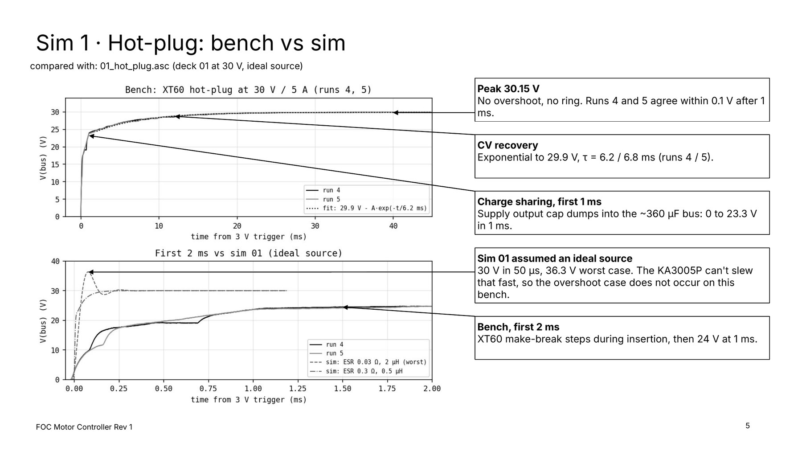</td>
    <td>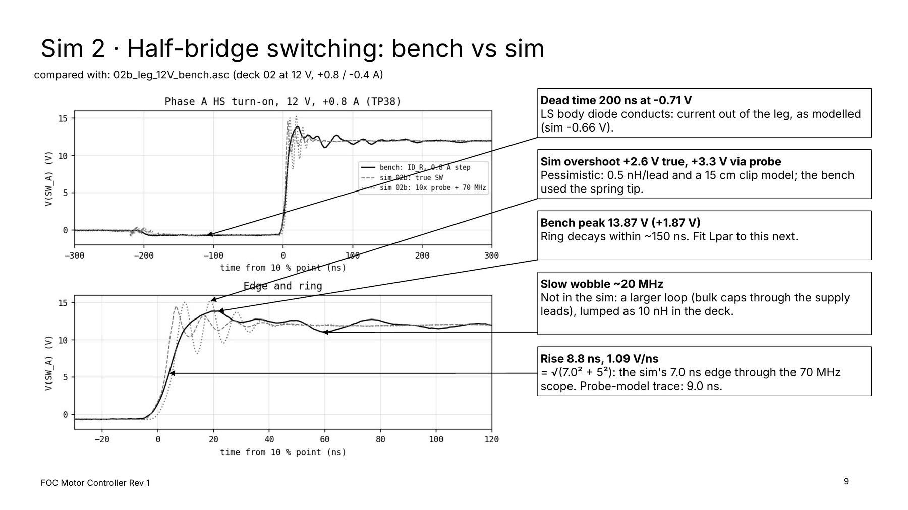</td>
    <td>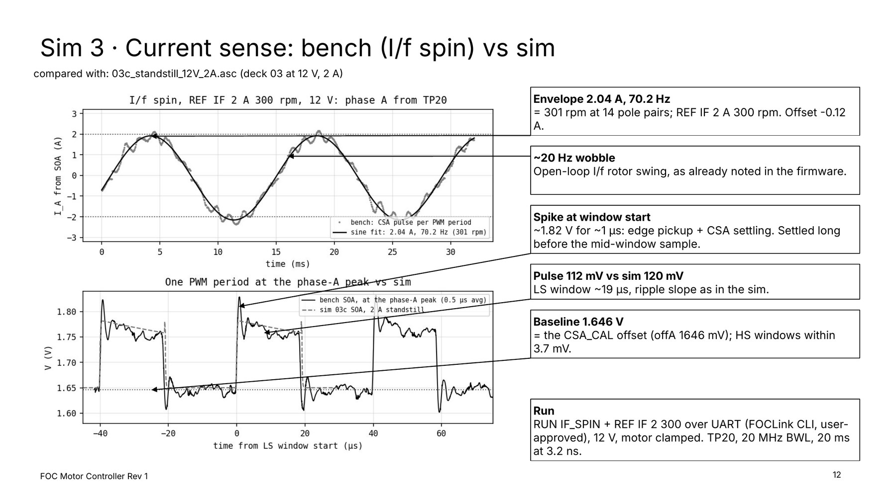</td>
  </tr>
</table>

| Deck | Question | Result |
|---|---|---|
| Hot-plug | Does plugging into a live 30 V supply overshoot the bus? | 30.15 V peak, no overshoot. The simulation's 36.3 V assumed an ideal source; the bench supply limits the inrush. |
| Half-bridge switching | How fast are the edges? | 8.8 ns rise at 12 V against 7.0 ns simulated. The difference is mostly the 70 MHz probe. |
| Current sense | Has the amplifier settled when the ADC samples? | 2.04 A envelope for a 2 A command; the 112 mV pulse matches the simulated 120 mV. |

**What we learned.** The models are close enough to use. One gap mattered later: the switching deck was only compared
with the phase *sourcing* current. The damaging edge turned out to be the other polarity (Part 4.3). Decks and captures
are in [`Simulation/`](Simulation/).

---

## Part 3: Running without an encoder (22 November 2026)

**Why.** There is no magnet mount for the encoder, so the board had no way to close a loop on rotor position. Sensorless
control was needed to move real power through the bridge.

**What we did.** Three new modes were written, simulated on the PC, then run on the board at 30 V: a speed loop that
starts open-loop and hands over to a flux observer, a position mode that steers a current vector, and a standstill scan
that looks for the rotor's magnetic saliency by injecting a small high-frequency voltage.

**What we found.**

- Closed-loop speed to 3000 rpm with no load, drawing 6 W at 1000 rpm and 21 W at 3000 rpm.
- 50 starts out of 50 reached closed loop, each in 2.45 s with a spread of 40 ms.
- The position mode parks the rotor wherever the current vector points. This became the main tool for Part 4: it puts a
  chosen DC current through a chosen phase with no mechanical load.
- The standstill scan finds the rotor angle when no torque current flows. It cannot track position under load: the
  bridge's voltage error is larger than the signal on this very low-inductance motor (about 9 µH).

**What we learned.** The board can run a motor usefully without its encoder, and a parked rotor makes a good electronic
load. Position sensing at standstill under torque still needs the encoder.

---

## Part 4: Characterizing the power stage (22 November 2026)

The question for this part: what does a firmware engineer have to respect, and what should Rev B change? The motor is
only a tool here. Parked, it is an inductor; spinning, it is a source of power and of kinetic energy.

A note on what is shown: runs that failed for probe contact, clipped captures and repeat runs are left out. They are all
in the lab notebook, [`Bench/CHAR_LOG.md`](Bench/CHAR_LOG.md).

### 4.1 Can the board's own measurements be trusted?

**Why.** Most later tests read values from the board. If its voltage and current readings are off, everything built on
them is off.

**What we did.** Compared the bus reading with a DMM. Put a battery-powered DMM directly across one shunt during 3 A and
5 A holds. Calibrated the current offsets eight times each at 12, 18, 24 and 30 V. Looked at the supply rails with the
scope.

**What we found.**

| Check | Result |
|---|---|
| Bus voltage | Reads 0.36 % low at 30 V |
| Current scale | −4.52 mV at 3 A and −7.57 mV at 5 A across 3 mΩ: correct within 1–2 % |
| Current offsets | Move less than 0.4 mV (7 mA) between 12 V and 30 V |
| Current noise | 20–27 mA rms per sample, the same whether the bridge switches or not |
| +3.3 V rail | At the scope's noise floor |
| +5 V rail | About 100 mV of ripple at 120–160 kHz from its own converter at light load |

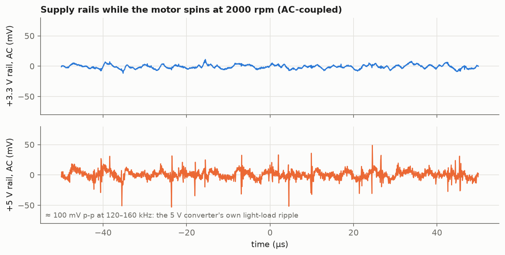

**What we learned.** The board's readings can be used as instruments. One method lesson: millivolt measurements with
the grounded scope were useless because of a ground loop; the floating DMM was the fix.

### 4.2 A first look at the switch node

**Why.** The switch node shows how fast the FETs switch, how much they overshoot, and whether the dead-time is what the
firmware thinks it is. It had never been looked at under current.

**What we did.** Parked the rotor with 1 A and 3 A flowing *out* of phase A and captured both edges.

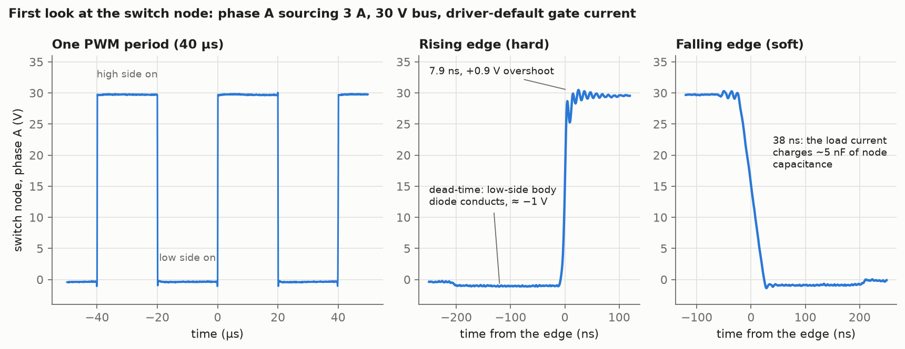

**What we found.** A hard rising edge of 7.9 ns with only 0.9 V of overshoot on a 30 V bus; a soft falling edge of
38 ns, driven by the load current charging about 5 nF of node capacitance; dead-time of 189–213 ns at the node.

The bus itself is quiet. Between edges it moves by about 20 mV; each hard edge puts a spike of up to ±0.4 V on it for
about 20 ns. With the motor spinning under real power the ripple is 58–79 mV peak to peak from 1000 to 3000 rpm.

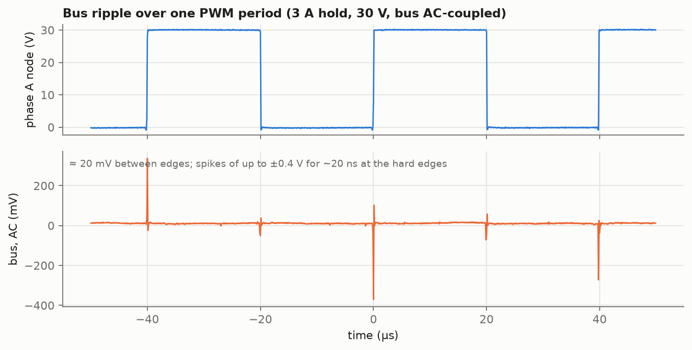

**What we learned.** It looked healthy. That was half the picture.

### 4.3 Reversing the current: the −10 V surprise

**Why.** With current flowing *into* the phase, the roles of the two FETs swap. The low-side FET now makes the hard
edge, pulling the node from the bus down to ground. This polarity had not been measured, on the bench or in simulation.

**What we did.** Rotated the parked current vector by 180° electrical so phase A sank 3 A, and captured the same edges.
Then repeated at three gate-drive strengths.

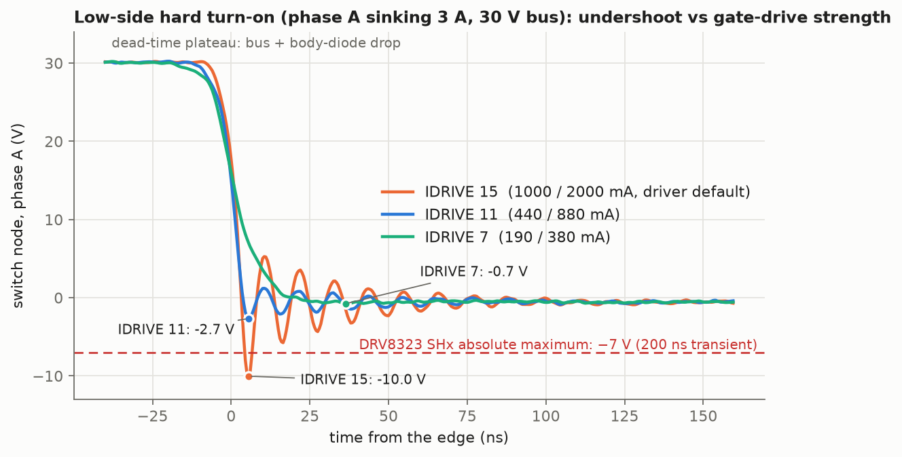

**What we found.** At the gate driver's power-on gate current (1 A source, 2 A sink) the node overshoots ground to
**−10 V** and rings at about 90 MHz for 80 ns. The driver's absolute maximum on that pin is −7 V. The shunt sees the same
burst: −4.6 V across a pin pair rated for ±3 V.

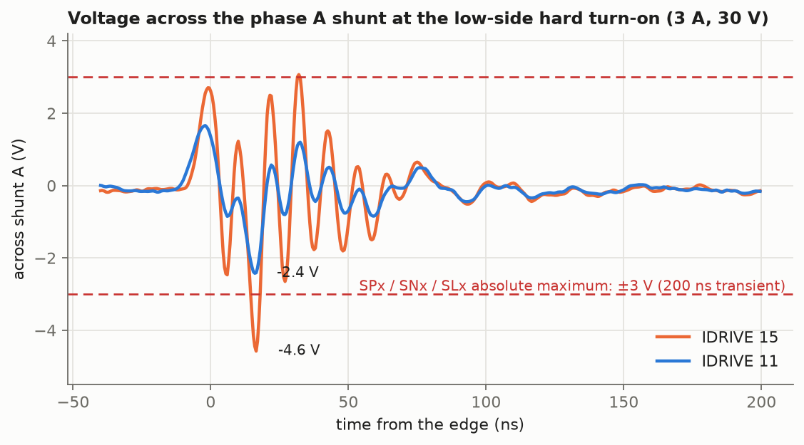

| Gate current (source / sink) | Edge time | Switch-node minimum | Across the shunt |
|---|---|---|---|
| 1000 / 2000 mA (driver default) | 7.1 ns | −10.0 V | −4.6 V |
| 440 / 880 mA | 8.9 ns | −2.7 V | −2.4 V |
| 190 / 380 mA | 18.4 ns | −0.8 V | not measured |

**What we learned.** Every run before this one had exceeded the driver's rating whenever a phase sank current. The board
showed no damage, but the default cannot be used on this layout. The firmware now powers up at 190 / 380 mA and refuses
anything above 440 / 880 mA. The cost is about 10 ns of edge time and roughly 20 mW per phase.

### 4.4 Does it get worse with voltage, with current, on the other phases?

**Why.** One operating point on one phase is not an envelope. The design point is 56 V and 10 A, so the trend matters
more than the number.

**What we did.** Repeated the edge capture at 12 V and 24 V, on phases B and C, at currents up to 10 A, and at even
slower gate settings. Also measured on the thin sense trace that carries the node voltage to the driver.

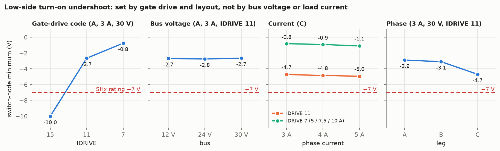

The same comparison as waveforms. Left: three bus voltages land on the same minimum. Right: phase C at 5, 7.5 and 10 A
at the slow gate setting.

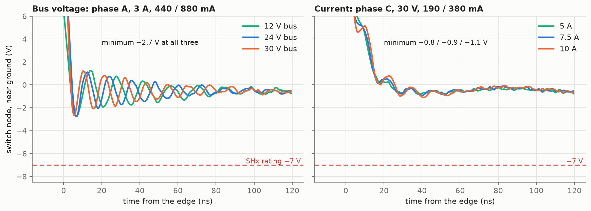

And the three phases at the medium gate setting, where phase C stands out:

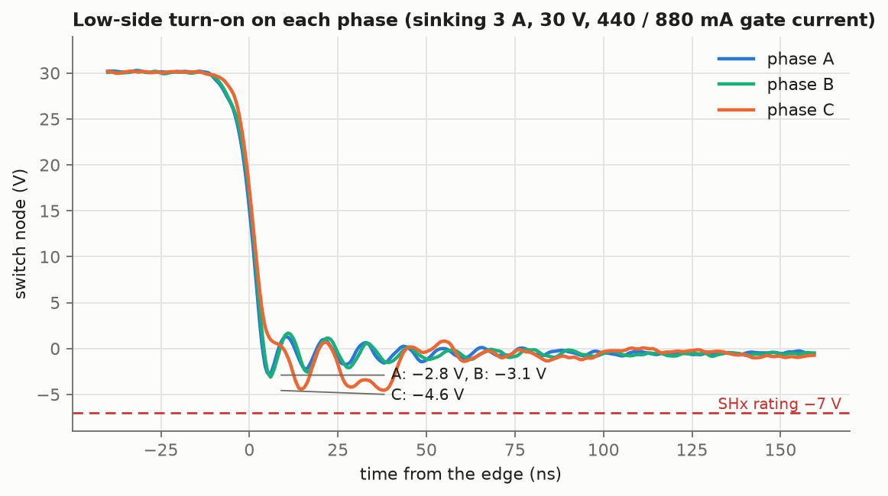

**What we found.**

- **Bus voltage does not matter:** −2.7 V at 12, 24 and 30 V.
- **Current barely matters:** about −0.1 V per amp. Phase C was still at −1.1 V with 10 A flowing.
- **Phase C is worse than A and B** at the medium gate setting, in five of five probe placements. Its half-bridge has a
  larger commutation loop.
- **Slower than 190 / 380 mA gains nothing.**
- The sense trace delivers the spike to the driver unfiltered.

**What we learned.** The ringing is a property of the edge and the layout, which is good news for the 56 V design
point, though still unproven above 30 V. Margins must be taken on phase C. One honest limit: these are hand-held probe
readings. Phase A repeats within ±0.2 V across five placements; phase C at the slow setting read either −3.4 V or
−0.9 V depending on placement, and the larger value is the one used.

### 4.5 Why phase C's current reads wrong at high duty

**Why.** Low-side shunts only carry the phase current while the low-side FET is on. At high duty that window is short,
and the firmware needs to know how short is too short.

**What we did.** Drove a fixed current while raising the common duty, shrinking the low-side window from 20 µs to under
1 µs, and compared the three readings. Then put the scope on phase C's amplifier output.

**What we found.** Phases A and B read correctly down to about 1.2 µs. Phase C failed first, at about 3 µs, reading half
the true current at 95 % duty. The amplifier was fine. The cause is the ADC: phases A and B are each converted first on
their converter, while phase C is second in a sequence, 0.9–1.5 µs later, after the window has closed.

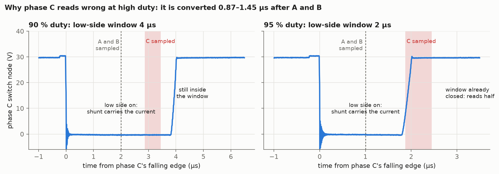

**What we learned.** A schematic-level choice of ADC pins cost 5 % of usable duty. The firmware now rebuilds whichever
phase has the shortest window from the other two, and phase C reads −0.79 A against −0.80 A on phase B where it read
−0.40 A before. Above about 95 % two phases are unreadable and nothing helps. Rev B should route the three signals so
that none waits behind another.

### 4.6 How fast does the firmware react to over-current?

**Why.** The firmware's trip decides how far a fault current can run. Its delay sets what it can and cannot protect
against.

**What we did.** Stepped the duty so phase A's current ramped through a 2.5 A limit, and watched two switch nodes to see
the exact moment the outputs went off.

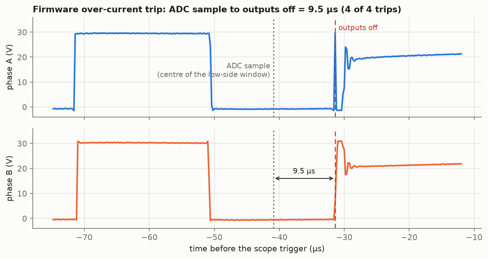

**What we found.** The outputs go off 9.5 µs after the ADC sample that sees the over-current, identically in four trips.
Since there is one sample per 40 µs period, the worst case from the current crossing the limit is about 50 µs.

**What we learned.** That is fast enough for overload and far too slow for a short circuit, where current can rise by
amps per microsecond. Short circuits have to be caught by the gate driver.

### 4.7 Does the short-circuit protection actually work?

**Why.** The gate driver watches the voltage across each conducting FET and shuts down if it is too high. It had never
been seen to trip, and nobody had checked what its threshold meant in amps on this board.

**What we did.** Set the threshold to its lowest value, 0.06 V. Ramped phase A's current with a duty step, using the
firmware trip as a ceiling at 10, 15, 20 and then 22 A, so each pulse was bounded.

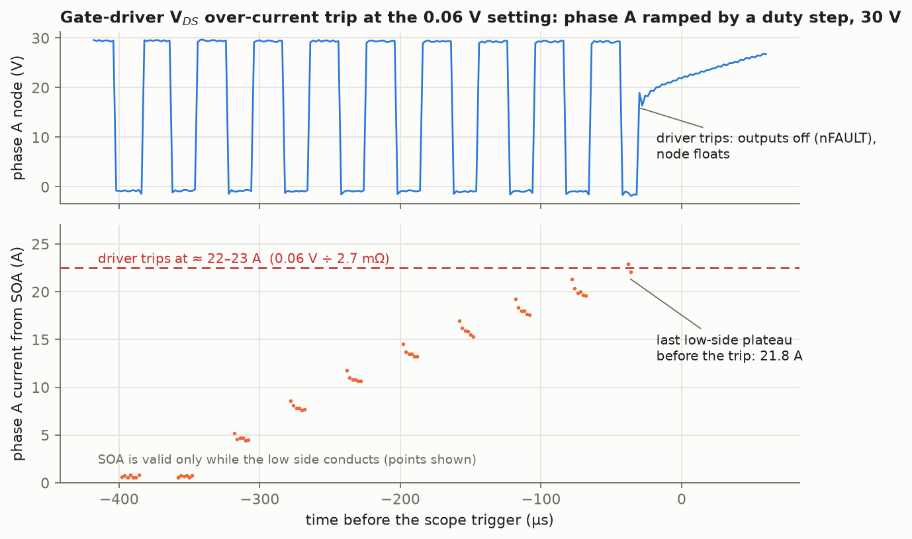

**What we found.** At 10, 15 and 20 A the firmware tripped first. At the 22 A ceiling the gate driver tripped first,
three times out of three, at 22–23 A. That is 0.06 V across 2.7 mΩ, the FET's on-resistance.

**What we learned.** The protection works, and its threshold is simply volts divided by 2.7 mΩ. The uncomfortable part
is what that says about the power-on setting of 0.75 V: **about 280 A**. The board had effectively no short-circuit
protection. The firmware now sets 0.13 V, about 48 A with cold FETs and about 30 A hot, and will not accept a looser
value. A second limit showed up here: the current sense runs out of range near 22 A, so firmware can neither see nor
protect above that.

### 4.8 Dead-time: who really sets it?

**Why.** During dead-time the current flows through a body diode and the output voltage is wrong by a small amount. That
error limits low-speed torque accuracy and is what blocks standstill position sensing. The obvious fix is a shorter
dead-time.

**What we did.** Built a test firmware with 100 ns of dead-time instead of 200 ns. Measured the voltage needed to hold
1–5 A with each, at both settings of the gate driver's own dead-time (100 ns and 50 ns). No probes were needed: the
voltage error is a direct measure of the effective dead-time.

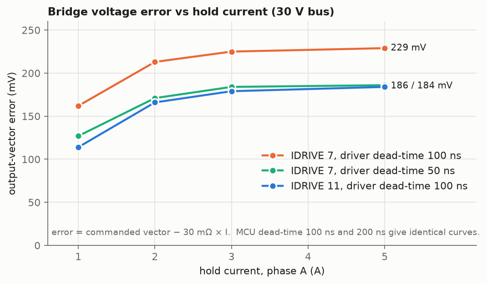

**What we found.** Halving the MCU's dead-time changed nothing, to within 3 mV. Changing the gate driver's setting from
100 ns to 50 ns removed 43 mV, exactly what 50 ns is worth at 30 V. Switching power at zero current stayed flat and
there were no faults, so there is no sign of shoot-through at any setting.

**What we learned.** The gate driver sets the real dead-time. It waits for the outgoing FET's gate to fall, then adds
its own delay, and at the slow gate drive that already exceeds the MCU's 200 ns. So the MCU value stays at 200 ns, the
driver is set to 50 ns, and the remaining error is 0.13–0.19 V. The slow gate drive from 4.3 costs about 45 mV of this;
that is the price of the clean switch node.

### 4.9 What happens when the motor brakes?

**Why.** A braking motor is a generator. The bench supply cannot absorb current, and neither can a battery connector
that has been unplugged. The only place for the energy is the bus capacitors.

**What we did.** Let the speed loop brake with up to 3 A and drop its speed command abruptly, from 1000, 2000 and
2500 rpm down to 300 rpm, starting from a 12 V bus so there was room to rise. A clamp was added first: braking is
withdrawn whenever the bus passes 90 % of the over-voltage limit, set here to 30 V.

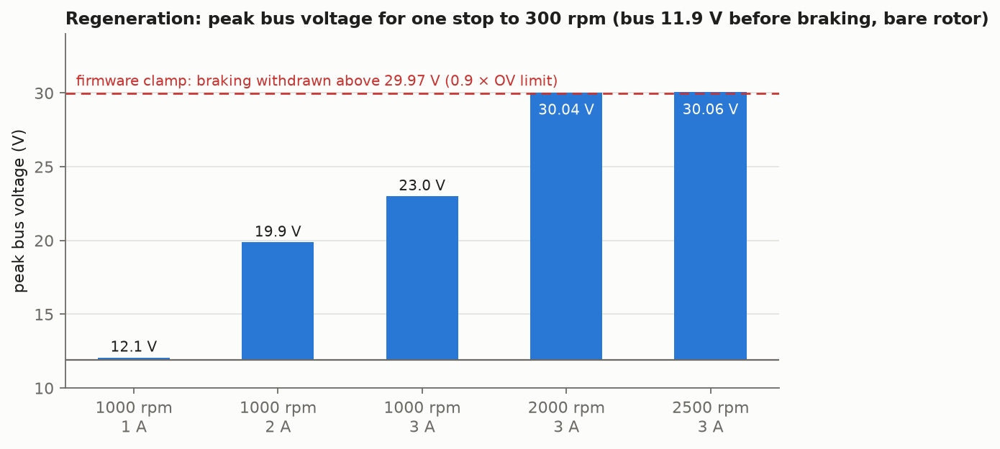

The same stops against time, as the firmware reported them over the serial link:

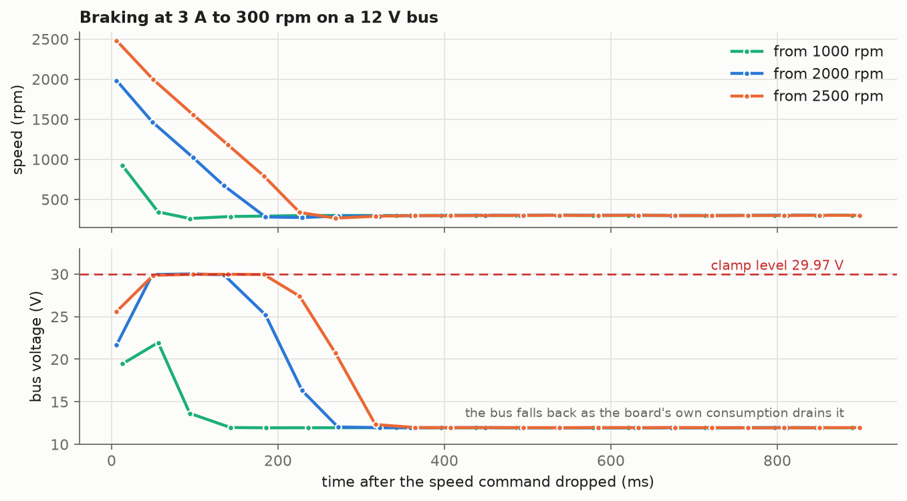

**What we found.**

- Up to about 1 A of braking, nothing happens: the board's own consumption uses the energy.
- At 3 A, one stop from 1000 rpm raised the bus from 12 V to 23 V.
- From 2000 and 2500 rpm the bus reached the clamp and stopped within 0.1 V of it, four times out of four. The stop took
  longer, because braking was being switched in and out, and the observer stayed locked.

**What we learned.** This was a bare rotor holding at most about 2.7 J. The capacitors take about 0.13 J between 12 V
and 30 V. A robot joint stores far more, so firmware must limit braking by bus voltage, which it now does, and Rev B
needs a braking resistor or an active clamp. More capacitance cannot solve it.

### 4.10 Heat

**Why.** The thermal limit decides the continuous current, and the board's temperature sensor is only useful if its
relation to the FETs is known.

**What we did.** Held 3 A and then 5 A in one phase for ten minutes each with a thermocouple on the low-side FET.

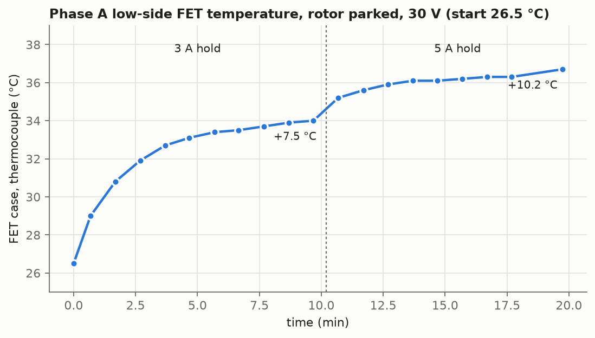

**What we found.** The FET case rose 7.5 °C at 3 A and 10.2 °C at 5 A in still air. The board's sensor reads 1.5–2 °C
above the FET case. Holding 10 A takes only 5.8 W from the supply for the whole board.

**What we learned.** Nothing alarming to 5 A. A two-point fit suggests about +23 °C at 10 A, but that is an
extrapolation; the 10 A hold is prepared and not yet run.

### 4.11 Losing power, losing the link, starting again

**Why.** A drive has to behave when things go away: the supply sags, the PC stops talking, the motor is asked to start
for the hundredth time.

**What we did.** Ramped the supply from 30 V down to 4 V and back with the board idle. Stopped the heartbeat while the
bridge was switching. Ran 50 sensorless starts.

**What we found.**

| Event | Behaviour |
|---|---|
| Supply sag | Keeps running down to 5 V, off at 4 V, restarts between 5 and 6 V with a clean reset; the analog supply holds 3.30 V throughout |
| Heartbeat lost | Outputs off at 501 ms for a 500 ms setting, five times out of five |
| STOP or DISARM command | Acted on within 11–44 ms, mostly USB-serial delay |
| 50 starts | 50 successes |

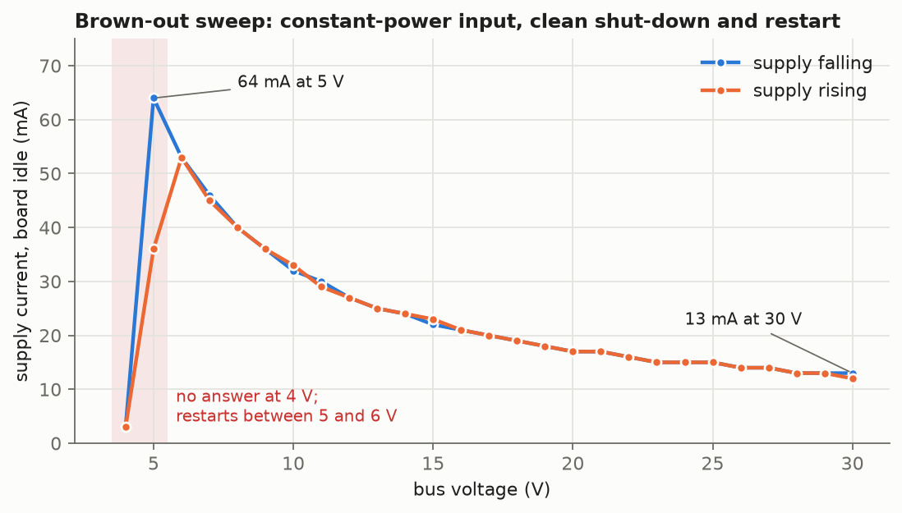

**What we learned.** No latch-up and no corrupted state. One detail for system design: the board draws more current as
the bus falls (27 mA at 12 V, 64 mA at 5 V), so a weak supply can stall on the way up.

### 4.12 Two loose ends tied off with the motor

**Why.** Two motor numbers had looked wrong since September, and wrong motor constants would cast doubt on the current
sense that measured them.

**What we found.**

- **Resistance.** Measured four-wire with the motor unplugged, the winding is 17.97 mΩ per phase, which matches the
  datasheet's 39 mΩ line-to-line. The old 98 mΩ had two causes: the bench supply's own leads add 110–145 mΩ, and the
  firmware's identification runs at 1 A, where the bridge's voltage error from 4.8 looks like extra resistance.

  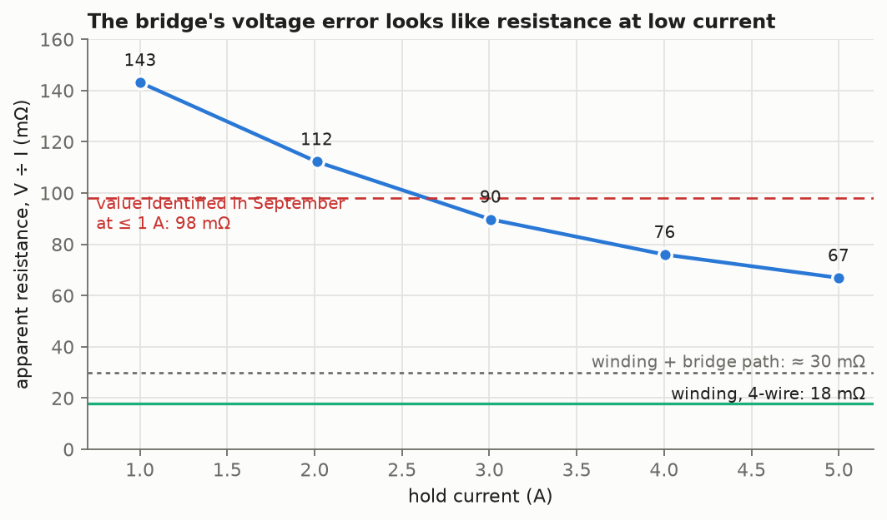

- **Flux constant.** With the outputs switched off and the rotor coasting, the back-EMF gives 1.396 mV·s, within 0.5 %
  of the value in use.

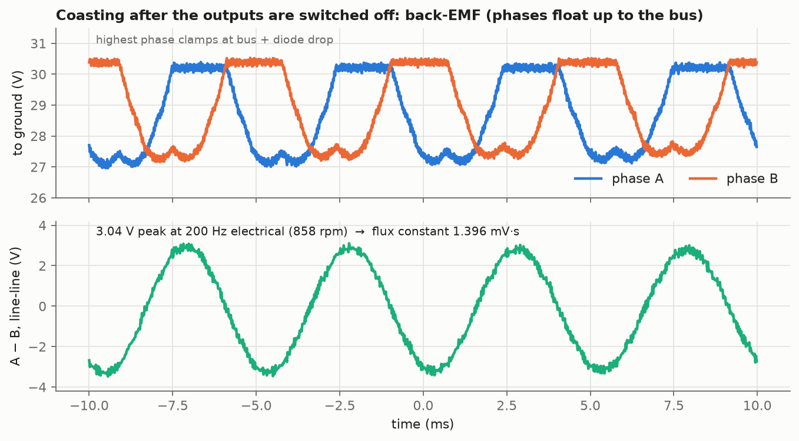

**What we learned.** The September mystery was a measurement artefact, not a board fault, and the current sense is
vindicated a second time.

---

## Part 5: What changed because of all this

**In firmware, already running on the board**

| Change | Because of |
|---|---|
| Gate current 190 / 380 mA at power-up, capped at 440 / 880 mA | 4.3, 4.4 |
| Short-circuit threshold 0.13 V, cannot be loosened | 4.7 |
| Gate driver dead-time 50 ns; MCU stays at 200 ns | 4.8 |
| The phase with the shortest low-side window is rebuilt from the other two | 4.5 |
| Braking withdrawn above 90 % of the over-voltage limit | 4.9 |
| Over-current check moved ahead of the encoder read | 4.6 |
| Refuses to arm on stale measurements | 1.2 |

**For Rev B**

| Priority | Change | Because of |
|---|---|---|
| High | A braking resistor or active bus clamp sized for the joint's energy | 4.9 |
| High | Current-sense outputs routed so both ADCs sample together, none second in a sequence | 4.5 |
| High | A hardware E-stop input independent of the gate driver's enable | Rev 1 has none |
| Medium | Review the commutation loop of phase C against A and B | 4.4 |
| Medium | Low-inductance shunt layout with Kelvin sensing and an input filter | 4.3 |
| Medium | Gate resistors, or footprints for them, so edge rate does not depend on a register that powers up at its fastest | 4.3 |
| Medium | Test points with a ground pad beside each: switch nodes, shunts, and the driver's own pins | Method limits below |
| Low | Stronger pull-up on the gate driver's SPI data line | 1.1 |
| Low | Encoder read that does not block the control interrupt | 3.5 µs of each 40 µs period |
| Low | Quieter +5 V rail if anything sensitive is added to it | 4.1 |

---

## Part 6: What we could not test, and how far to trust the numbers

**Not tested**

- Above 30 V and above 10 A. The 56 V design point is extrapolation.
- FET temperature at 10 A (prepared, about six minutes of work).
- The gate driver's reaction time on a short-circuit trip; the capture was too coarse. The datasheet says 4 µs plus gate
  turn-off.
- Efficiency under shaft load, bus-capacitor ripple at full power, the high-side gate waveform, EMC.
- Anything using the encoder.

**How far to trust the numbers**

- A 70 MHz scope and a hand-held probe under-read 7–9 ns edges. Real peaks are higher than stated.
- Switch-node voltages are measured against the shunt's ground, not the gate driver's own ground. The only access to
  the driver's pin is a 0.5 mm pad 1.3 mm from the gate pads.
- Energy figures for braking rest on an estimated rotor inertia, and the bench supply's output capacitor was in
  parallel with the bus, so the board alone would rise further.

---

## Where everything is

| Path | Contents |
|---|---|
| [`Bench/CHAR_LOG.md`](Bench/CHAR_LOG.md) | The lab notebook: every run with its conditions and numbers, including failed and repeated ones |
| [`Bench/char/`](Bench/char/) | Raw waveforms, scope screenshots and per-test data |
| [`Bench/report/`](Bench/report/) | The figures in this report, regenerated by `Bench/make_report_figs.py` |
| [`Bench/PROBE_MAP.png`](Bench/PROBE_MAP.png) | Top view of the board with every test point and usable ground pad |
| [`Simulation/`](Simulation/) | The three LTspice decks and their scope captures |
